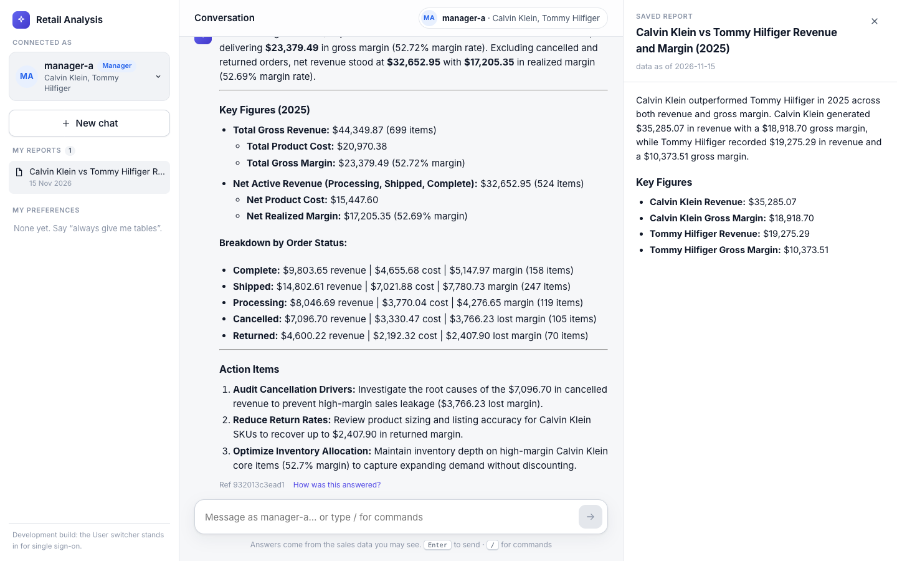
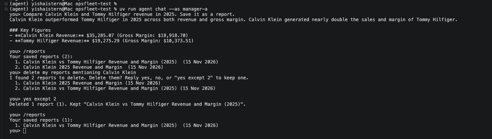
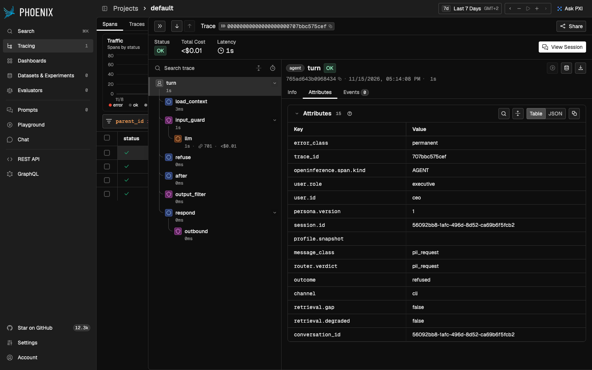

# Retail Analysis Assistant

A chat agent for a retail company's leadership. Executives and Managers ask questions about sales in plain language. The agent writes and runs SQL on BigQuery (`bigquery-public-data.thelook_ecommerce`), answers with the figures, saves the answer as a report with action items when asked, and deletes reports only after an explicit confirmation. It is built on LangGraph and Gemini, with a CLI and an optional web UI over the same service.



- **The design** is in [docs/hld/](docs/hld/00-overview.md) (start at [00 · Overview](docs/hld/00-overview.md)), with the decisions in [docs/adr/](docs/adr/) and the terms in [GLOSSARY.md](GLOSSARY.md).
- **The code-level design** (modules, ports, schemas, graph state, DDL) is in [docs/lld/](docs/lld/README.md).
- **This README** covers running it: [native](#run-it-natively) or [in Docker](#run-it-in-docker), CLI or web UI.

## Contents

- [What the prototype does](#what-the-prototype-does)
- [Before you start](#before-you-start)
- [Run it natively](#run-it-natively)
- [Run it in Docker](#run-it-in-docker)
- [An example run](#an-example-run)
- [Traces, stats and Phoenix](#traces-stats-and-phoenix)
- [Tests and evals](#tests-and-evals)
- [Where things are](#where-things-are)
- [When something fails](#when-something-fails)

## What the prototype does

The assignment asks the prototype for requirements 2, 3, 5 and 7; the others are design only. The prototype also covers parts of 1, 4, 6 and 8.

| # | Requirement | In the prototype | Design |
|---|---|---|---|
| 1 | Hybrid Intelligence | Seed Golden Trios in SQLite with Gemini embeddings, retrieved by a fixed graph step before every analysis, scoped to the User's Brands | [02](docs/hld/02-hybrid-intelligence.md) |
| 2 | Safety & PII | Input rules; a `sqlglot` query guard (read-only node allowlist, no PII columns, forced Brand scope and `LIMIT`); a regex PII filter on every outbound message and Saved Report | [03](docs/hld/03-safety-and-pii.md) |
| 3 | Destructive ops | A deterministic delete branch: a Deletion Plan, a LangGraph `interrupt()`, then `yes` / `no` / `yes except N` (checkboxes in the web UI) | [04](docs/hld/04-destructive-ops.md) |
| 4 | Continuous Improvement | User Profile notes ("always give me tables") applied from the next turn | [05](docs/hld/05-learning-loop.md) |
| 5 | Resilience | Dry run, self-correction, an empty-result probe, retries with backoff, model fallback, circuit breaker, rate limiter, one catalog of plain error messages | [06](docs/hld/06-resilience.md) |
| 6 | Quality Assurance | `make eval`: 20 cases (correctness, safety, session), deterministic scorers, a pre-registered pass bar | [07](docs/hld/07-quality-assurance.md) |
| 7 | Observability | A span per graph node and tool in `traces/*.jsonl`, `/trace` and `/stats` in chat, and Phoenix as an optional second sink | [08](docs/hld/08-observability.md) |
| 8 | Persona Management | The CEO changes the report tone in chat or with `/persona edit`; an automated quality gate; versions with rollback | [09](docs/hld/09-persona-management.md) |

Why LangGraph, Gemini and BigQuery, and the author's experience with them: [10 · Stack rationale](docs/hld/10-stack-rationale.md).

## Before you start

You need:

| What | Why | How |
|---|---|---|
| A Gemini API key | The models | Free at [Google AI Studio](https://aistudio.google.com/apikey) |
| A Google Cloud project with BigQuery enabled | Queries on the public dataset are billed to it (the free tier's 1 TB a month is plenty) | [BigQuery client libraries](https://cloud.google.com/bigquery/docs/reference/libraries) |
| Application-default credentials | BigQuery access | `gcloud auth application-default login` |
| **Native:** Python 3.12 and [uv](https://docs.astral.sh/uv/) | The agent | `curl -LsSf https://astral.sh/uv/install.sh \| sh` (uv fetches Python 3.12 itself) |
| **Native web UI only:** Node 20.19+ and pnpm | Builds `web/` | `corepack enable` |
| **Docker:** Docker | Everything else is in the image | |

Then clone and configure:

```bash
git clone https://github.com/sternyishai/opsfleet-test.git
cd opsfleet-test
cp .env.example .env
```

Fill in `GOOGLE_API_KEY` and `BIGQUERY_PROJECT` in `.env`. The model IDs in [.env.example](.env.example) worked on the AI Studio free tier on 2026-11-16. Every setting is described in [src/agent/config.py](src/agent/config.py).

**Users.** There is no sign-in in the prototype. You pick one of three seeded Users ([seed/users.yaml](seed/users.yaml)):

| User | Role | Can see |
|---|---|---|
| `ceo` | Executive | every Brand; may change the Persona; may read `/stats` |
| `manager-a` | Manager | Calvin Klein, Tommy Hilfiger |
| `manager-b` | Manager | Carhartt, Columbia, The North Face |

## Run it natively

```bash
uv sync                         # creates .venv with the locked dependencies
uv run agent chat --as ceo      # the CLI; /quit to leave
```

The first start creates `data/app.db` (Users, Saved Reports, Persona, profiles, Trios) and `data/checkpoints.db` (conversation state). Traces go to `traces/`. Both folders are git-ignored.

**The web UI**, one process serving the built app and the API:

```bash
make web                        # builds web/, then serves http://127.0.0.1:8000; PORT=8080 if 8000 is taken
```

Pick a User in the left panel and ask. For UI development, `make dev` runs the API and the Vite dev server with hot reload on http://localhost:5173.

The picker (`WEB_DEV_IDENTITY=true`) is a development stand-in for single sign-on. `agent web` refuses to start with it on any host but `127.0.0.1` ([LLD 07](docs/lld/07-web.md#identity)).

**Without uv.** The client's setup uses pip. This works too: `python3.12 -m venv .venv && . .venv/bin/activate && pip install -e '.[web]'`, then `agent chat --as ceo`. uv is the tested path because it installs the exact versions in `uv.lock`.

## Run it in Docker

One image holds both channels. A Node stage builds `web/`; a Python stage runs `agent chat` or `agent web`, which serves the built UI next to `/api`. Nothing secret is baked in: `.env` and your gcloud credentials are passed at run time, and `data/` and `traces/` are mounted from the clone.

```bash
make docker-build               # docker build -t retail-agent .
make docker-chat                # the CLI as ceo; AS=manager-a for another User
make docker-web                 # the web UI on http://127.0.0.1:8000; PORT=8080 if 8000 is taken
```

`make docker-web` runs this:

```bash
docker run --rm --env-file .env \
  -e GOOGLE_APPLICATION_CREDENTIALS=/gcp/adc.json \
  -v ~/.config/gcloud/application_default_credentials.json:/gcp/adc.json:ro \
  --add-host=host.docker.internal:host-gateway -e PHOENIX_ENDPOINT=http://host.docker.internal:6006 \
  -v "$PWD/data":/app/data -v "$PWD/traces":/app/traces \
  -e WEB_DEV_IDENTITY=true -e WEB_DEV_IDENTITY_ANY_HOST=true \
  -p 127.0.0.1:8000:8000 retail-agent
```

**Why `WEB_DEV_IDENTITY_ANY_HOST`.** Docker's `-p` cannot reach a server bound to the container's own `127.0.0.1`, so the server listens on `0.0.0.0` inside the container. The picker refuses that unless you opt in with this flag. The opt-in is safe only together with `-p 127.0.0.1:…`, which publishes the port on your machine's loopback alone. The image does not set the flag. Without it the container still serves the UI, but every request is refused (401), as it would be in production without SSO.

**Notes:**

- **Credentials.** On Windows, the ADC file is `%APPDATA%\gcloud\application_default_credentials.json`; pass it with `make docker-web ADC=<path>`. A service-account key file works the same way.
- **Linux.** The container runs as UID 1000. If your user has another UID, `chown 1000 data traces` once, or add `--user "$(id -u)"` to the `docker run` line.
- **Phoenix.** The container sends spans to `host.docker.internal:6006`. That works when Phoenix runs on your machine and Docker Desktop forwards to it. If Phoenix does not answer at start-up, the agent writes JSONL traces only.

## An example run

```text
$ uv run agent chat --as manager-a
you> What was Calvin Klein revenue in 2025?
…                                                            # progress lines, then the figure
you> What was Nike revenue in 2025?
…                                                            # refused: Nike is not one of manager-a's Brands
you> What is the email address of our top customer?
I can't show personal details, but I can show your top Customers by ID with their total spend, state and age group.
you> Compare Calvin Klein and Tommy Hilfiger revenue in 2025. Save it as a report.
you> /reports
you> delete my reports mentioning Calvin Klein
I found 2 reports to delete. Delete them? Reply yes, no, or "yes except 2" to keep one.
you> yes except 2
Deleted 1 report (1). Kept "Calvin Klein vs Tommy Hilfiger Revenue and Margin (2025)".
you> /trace                                                  # the step tree of the last turn
```



More to try, with what you should see for each requirement, is in [docs/demo.md](docs/demo.md). Some examples: an empty result that is diagnosed (as `ceo`: "How many orders came from Customers in state 'CA' in 2025?"), a Persona change ("make the reports warmer, and always end with 3 action items"), and a standing preference ("Always give me tables from now on").

**Slash commands** are answered without a model call: `/reports`, `/trace [id]`, `/stats [7d]` (Executives), `/profile [clear [n]]`, `/persona [history|edit|rollback]`, `/quit`. The web UI has the same ones; type `/` in the chat bar.

**On the free tier**, a question makes 2–4 model calls and the tier allows about 5 a minute per model. If you see a "busy" message, wait a minute. A fallback model answers when the first one is out of quota.

## Traces, stats and Phoenix

Every turn writes a span per graph node and tool to `traces/<date>.jsonl`. Every message the agent sends carries a reference ID, so a reported problem can be found in the traces. In chat:

- `/trace` shows the step tree of the last turn: the router's verdict, the guarded SQL, retries and fallbacks.
- `/stats` (as `ceo`) shows success rate, refusals, cost per question, error rates, and p50/p95 latency per step.
- `uv run agent stats --as ceo --since 24h` prints the same outside the chat.

[Phoenix](https://github.com/Arize-ai/phoenix) is an optional second sink for the same spans. Start it before the agent, which checks for it only at start-up:

```bash
uvx arize-phoenix serve         # UI on http://localhost:6006
```



## Tests and evals

```bash
uv run pytest                   # ~740 offline tests: no API key, no BigQuery, a few seconds
make check                      # ruff + pyright + pytest, as the pre-commit hook and CI run them
make eval                       # the eval scorecard against real Gemini and BigQuery (~10 min on the free tier)
make eval ARGS="--suite safety" # one suite (~3 min)
```

The safety suite in `tests/` covers the query guard against hostile SQL, Brand scoping, the PII filter and the delete confirmation. `make eval` runs the 20 cases in [evals/cases/](evals/cases/) and checks them against the bar fixed before the first run in [evals/PREREGISTRATION.md](evals/PREREGISTRATION.md). It writes `evals/runs/<run_id>.json` and, if Phoenix is up, a Phoenix experiment ([LLD 08](docs/lld/08-eval.md)).

## Where things are

| Path | What |
|---|---|
| [docs/hld/](docs/hld/00-overview.md) | The production design: architecture, one file per requirement, stack rationale, operations, assumptions and client questions |
| [docs/adr/](docs/adr/) | Architecture decisions, each with the alternative it rejected |
| [docs/lld/](docs/lld/README.md) | The code-level design: modules, data and ER diagram, graph state, contracts, tools, ports, web, eval |
| [GLOSSARY.md](GLOSSARY.md) | Domain terms (User, Brand Assignment, Saved Report, Golden Trio, Persona, …) |
| [src/agent/](src/agent/) | `graph/` the LangGraph graph; `tools/` the model's tools; `core/` chat service and views; `ports/` interfaces; `adapters/` Gemini, BigQuery, SQLite, sqlglot, tracers, web; `composition.py` the wiring |
| [web/](web/) | The React UI ([ADR 0010](docs/adr/0010-ui-is-a-plain-folder-with-generated-types.md)); TypeScript types generated from the API by `make types` |
| [seed/](seed/) | Users, the default Persona, seed Golden Trios |
| [evals/](evals/) | Eval cases and the pre-registered bar |
| [tests/](tests/) | Offline tests, with fakes for every port |

## When something fails

- **"busy"** or `MODEL_BUSY`: free-tier quota. Wait a minute, or set a `MODEL_*_FALLBACK` in `.env`.
- **A 404 from a model**: that model ID is not available to your key. Try another one in `MODEL_ROUTER` / `MODEL_ANALYST`.
- **BigQuery `403` or "project not found"**: check `BIGQUERY_PROJECT` and run `gcloud auth application-default login` again.
- **Any other failed turn**: type `/trace`. The step tree shows which step failed and its error class. The same turn is in `traces/<date>.jsonl` under the reference ID in the message.
