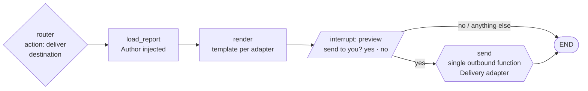

# Outbound actions are a router-opened `deliver` branch behind a Delivery port

The assignment asks for a system that is easy to extend with capabilities such as "sending reports by email". A capability that sends data out of the system (email, a Slack post, a push notification) is not added as a tool of the analysis sub-agent. It goes through one fixed branch, `deliver`:

- **Only the router opens it**, from the User's own message ("email it to me"). The analysis model can never call it, so text inside query results or Trios cannot make the system send anything.
- **It sends a result that already exists.** `deliver` never runs SQL. It loads a Saved Report by ID, with the Author injected from graph state, the same way the report tools do. An answer that was not saved yet is saved first: asking to send it is an explicit request to keep it ([04](../hld/04-destructive-ops.md)). Raw query rows never leave.
- **The recipient comes from code, never from the model.** By default it is the Author's own address or channel identity from SSO ([12](../hld/12-assumptions-and-open-questions.md)).
- **It confirms first.** The branch pauses with `interrupt()` and shows what will be sent and to whom, the same pattern as the Deletion Plan.
- **It leaves through the single exit.** Delivery adapters are called only from the outbound function that runs the output PII filter ([ADR 0003](0003-layered-data-access-enforcement.md)), so delivered content is filtered like every other message.
- **New destinations are adapters.** A `Delivery` port has one adapter per destination: email, Slack, push. Adding one is an adapter and a wiring change, with no change to the graph ([ADR 0006](0006-ports-and-adapters.md)).

## The flow

- **Destination.** The router returns a `destination` with the action, from the User's words ("email it" → `email`). It is an enum (`email`, `slack`, `push`) checked in code. If none is named, the User Profile's default is used, then the current channel. A registry maps the enum to an adapter.
- **No model in the branch.** Each adapter renders the Saved Report with a template: email gets the full answer and tables, Slack gets the title, summary, main table and a link, and push gets only the title and a link. The short **summary** is written by the analysis sub-agent when it calls `save_report`, in the same turn as the figures it describes, so `save_report`'s PII filter covers it. Nothing new is written after the save.
- **PII is checked twice, both times by existing code.** Once at save time, and again at the single exit, which filters the preview and the sent message.
- **The interrupt, then the send.** `load_report` and `render` have no side effects, so they can run again safely when the graph resumes. `send` runs only after "yes", and it uses an idempotency key (report ID, report version, destination), so a retry after a crash never sends twice ([LangGraph: interrupts](https://docs.langchain.com/oss/python/langgraph/interrupts#side-effects-called-before-interrupt-must-be-idempotent), [fault tolerance](https://docs.langchain.com/oss/python/langgraph/fault-tolerance#protect-side-effects-with-an-idempotency-key)).
- **The next round.** The User's reply resumes the paused graph. "No" cancels, and any other message cancels and enters at the input guard, the same rules as a Deletion Plan ([04](../hld/04-destructive-ops.md#the-confirmation-flow)). After a send, the branch replies "Sent to …" and ends. It records `last_delivery` (report, destination, outcome) in graph state, so a later "send it to Slack too" can resolve "it". The next message starts a normal turn.

**An isolated branch that can grow into its own agent.** `deliver` is a subgraph with a narrow contract. It takes a report ID and a destination, reads the Author from state and returns a delivery outcome. It shares no state with the analysis sub-agent. If delivery grows (scheduled or bulk sends, retries across vendors, or a destination that needs model-written text), the subgraph can move into its own agent or service without changing the shell. Three things never change: only the router opens it, the recipient comes from code, and content passes the output PII filter before it leaves.

**When the message also asks for analysis** ("create the Q1 report and email it to me"), the router returns `analysis` as the action and `deliver` as a *follow-up action*. Analysis runs first and saves the report, and a fixed edge then runs `deliver` on it. This is the reverse of the deferred request after a delete or Persona change ([01](../hld/01-architecture.md#agent-graph)), because delivery needs the result.

This applies the rule of [ADR 0004](0004-hybrid-agent-graph.md) to a third kind of action: one that **sends data outside the system**. Capabilities that only read and that the model chooses mid-analysis, such as charts or web search, stay tools of the analysis sub-agent.

The branch is added together with the first outbound adapter. Until then, the router keeps its four actions.

## Considered Options

- **A `send_email` tool in the analysis sub-agent** (the earlier wording in 01 and ADR 0004): the cheapest, but the model holds a send action, and an injected instruction in a query result or a Trio could make it send a report to an address it chose. Rejected. LangChain's own example puts `send_email` behind a human-in-the-loop interrupt, where the human may "change the recipient before sending" ([LangChain: human-in-the-loop](https://docs.langchain.com/oss/python/langchain/human-in-the-loop#interrupt-decision-types)). That still leaves the model choosing the send and the recipient. The approval only catches mistakes. Our analysis agent already reads private data and untrusted text (product names, Trios), and adding a way to send out completes the "lethal trifecta" ([Willison](https://simonwillison.net/2025/jun/16/the-lethal-trifecta/)). OWASP's fix for an email plugin is the same as ours: the User reviews and sends, and that control can sit outside the model ([OWASP LLM06](https://genai.owasp.org/llmrisk/llm062025-excessive-agency/)).
- **A model drafts the message per destination**: flexible formats, but it writes new text after the save. That needs its own PII check, a check that the figures match the report, and a template fallback, plus one model call per send. Rejected for now. It is the first step if a destination ever needs text a template cannot produce.
- **A delivery sub-agent** (tools grouped behind their own ReAct loop): isolates context, but adds a model loop to every send and still lets a model decide to send. Grouping tools pays off when one agent has too many tools ([LangChain: multi-agent](https://docs.langchain.com/oss/python/langchain/multi-agent/index#why-multi-agent)); the analysis sub-agent has six. Rejected today. The isolated subgraph is the place where it would go if delivery ever needs one, still opened only by the router.
- **Delivery inside the Channel Gateway**: the Gateway already talks to Slack, but it sits after the single exit and does not know Saved Reports or their Authors. Rejected.

## Consequences

- The router gains one action and an optional follow-up action field, and its per-step eval gains a case set for mixed messages ("… and email it").
- No extra model call on a send: `deliver` is deterministic code plus one confirmation. The destination comes from the router call that already runs.
- The Saved Report gains a `summary` field, and the `save_report` contract asks for it. Both are added with the branch, not before.
- Scheduled reports and push notifications reuse the branch. A Cloud Scheduler job starts a turn as the report's Author and enters `deliver` directly.
- Who may receive a report beyond its Author is a client question ([12](../hld/12-assumptions-and-open-questions.md)). Sending to others would change the rule that Saved Reports are never shared.
- When the analysis sub-agent's read tools grow past roughly 10–20, the first step is filtering tools per role or per turn ([LangChain: selecting tools](https://docs.langchain.com/oss/python/langchain/context-engineering#selecting-tools)). Only if that is not enough are they grouped into specialist sub-agents. Web search is the first candidate, because its results are large.
- Not in the prototype.
