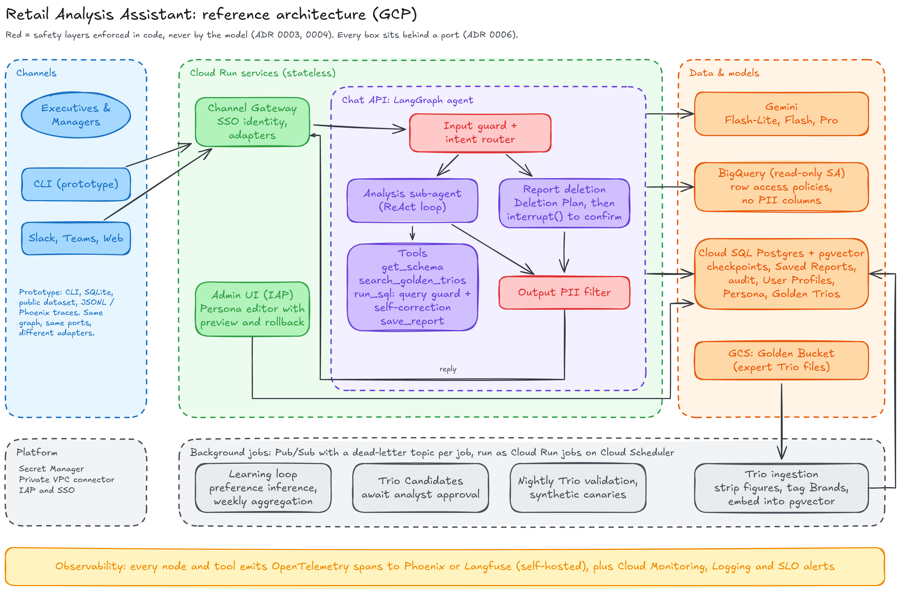

# 00 · Overview

The Retail Analysis Assistant is a chat agent for the Retail Company's non-technical leadership. Executives and Managers ask questions about sales and performance in plain language ("Why did churn spike last month?"). The agent answers by writing and running SQL against the transaction data in BigQuery, using how human analysts approached similar questions before. Users can discuss the answer, save it as a Saved Report and delete their own Saved Reports.

This HLD describes the production system. The prototype in this repo implements the slice marked in [Requirement map](#requirement-map), using the same agent graph and the same ports with lighter adapters (see [Prototype vs. production](#prototype-vs-production)). Domain terms (User, Manager, Brand Assignment, Saved Report, Trio, Persona, …) are used as defined in [GLOSSARY.md](../../GLOSSARY.md).

## Architecture at a glance

Source: [diagrams/architecture.excalidraw](diagrams/architecture.excalidraw). Open it at excalidraw.com to edit.

**One question, end to end:**

1. A User asks in a channel (the CLI in the prototype; Slack, Teams or web in production). The **Channel Gateway** resolves who they are through SSO and passes the message, with the User's role and Brand Assignments, to the **Chat API**.
2. The Chat API runs a **LangGraph** agent. Its outer shell is fixed: the **input guard and intent router** rejects off-topic or malicious input and sends the message down one of two branches.
3. **Analysis** questions go to a ReAct sub-agent. It reads the schema, retrieves similar **Golden Trios** to learn the analysts' method, and runs SQL through `run_sql`. `run_sql` parses every statement, scopes it to the User's Brands, caps its cost and self-corrects on errors or empty results.
4. **Delete requests** go to a deterministic branch. It builds a **Deletion Plan** listing exactly which reports match and why, and pauses for the User's confirmation before deleting anything.
5. Every reply passes the **output PII filter** before it goes back through the Gateway.
6. Background jobs keep the Golden Bucket current, learn User preferences and turn interaction data into eval cases and Trio Candidates. Every step emits **OpenTelemetry** traces.

## Design principles

- **The model is never a security boundary.** Brand scoping, PII protection and delete confirmation are enforced by code and by the data platform, in layers. A prompt injection can at most produce a bad *question*, never an unauthorized *answer* ([ADR 0003](../adr/0003-layered-data-access-enforcement.md)).
- **Fixed where it must be safe, flexible where it must think.** Safety steps are fixed graph edges the model cannot skip. Only the analysis core is an open-ended ReAct loop ([ADR 0004](../adr/0004-hybrid-agent-graph.md)).
- **Trios teach method, not figures.** Golden knowledge shapes *how* the agent analyses. The numbers always come from a fresh query scoped to the User ([ADR 0005](../adr/0005-golden-trios-teach-method-not-figures.md)).
- **Every external dependency sits behind a port.** Models, BigQuery, storage, channels and tracing can each be swapped with one adapter and one wiring change. That is what makes "easy to extend" and "portable" true in code ([ADR 0006](../adr/0006-ports-and-adapters.md)).
- **Humans approve every change to what the system knows.** Users' own preferences apply immediately. System-level learning (new Trios, prompt changes) goes through an analyst and the eval suite, never self-modification in production.
- **Right-sized for the client's scale.** About 1,000 questions a day and a few concurrent Users. The design uses no machinery that scale doesn't need, and names a growth path for each limit.

## Requirement map

| # | Requirement | How it is met (one line) | Detail | Prototype |
|---|---|---|---|:---:|
| 1 | Hybrid Intelligence | Figure-stripped Trios in pgvector, retrieved per question by `search_golden_trios`. Grown through analyst-approved Trio Candidates. | [02](02-hybrid-intelligence.md) | — (stretch) |
| 2 | Safety & PII | Input guard, an AST query guard that forces Brand scope, a PII-free schema, an output PII filter and a least-privilege account. | [03](03-safety-and-pii.md) | ✅ |
| 3 | Destructive ops | A deterministic delete branch: Deletion Plan, then `interrupt()`, then deletion of confirmed IDs only. Hard delete and audit row in one transaction. | [04](04-destructive-ops.md) | ✅ |
| 4 | Continuous Improvement | A structured User Profile (explicit, then inferred). System learning through aggregation, analyst review and an eval gate. | [05](05-learning-loop.md) | — |
| 5 | Resilience | Dry run, then bounded retries, then one empty-result diagnosis, then a graceful answer. Timeouts, backoff, model fallback and circuit breakers. | [06](06-resilience.md) | ✅ |
| 6 | Quality Assurance | Three offline suites (correctness, a safety red team gated at 100%, UX). Online LLM-judge sampling and canaries. | [07](07-quality-assurance.md) | partial |
| 7 | Observability | OpenTelemetry spans per node and tool. Quality, safety, cost and reliability metrics. SLOs with alerts. | [08](08-observability.md) | ✅ |
| 8 | Persona Management | A versioned Persona in Postgres, edited in an Admin UI and loaded with a ~60 s cache. No redeploy. | [09](09-persona-management.md) | — |

## Key decisions

| ADR | Decision | Main alternative rejected |
|---|---|---|
| [0001](../adr/0001-langgraph-agent-framework.md) | LangGraph is the agent framework | Google ADK (younger, more manual human-in-the-loop) |
| [0002](../adr/0002-postgres-for-app-state.md) | One Postgres (JSONB + pgvector) holds all app state | MongoDB, or separate stores (no atomic delete-and-audit) |
| [0003](../adr/0003-layered-data-access-enforcement.md) | Data access is enforced in layers outside the model | Prompt-only filtering |
| [0004](../adr/0004-hybrid-agent-graph.md) | Deterministic shell around a ReAct analysis core | A single ReAct agent (safety depends on the model) |
| [0005](../adr/0005-golden-trios-teach-method-not-figures.md) | Trios are stored figure-stripped and Brand-tagged | Injecting full Trios (leaks across Brands) |
| [0006](../adr/0006-ports-and-adapters.md) | Ports and adapters for every external dependency | Direct SDK calls |
| [0007](../adr/0007-in-process-tools-mcp-as-growth-option.md) | Tools run in-process; MCP only as a growth option | MCP server per data source (ports already give swappability) |

Smaller decisions are explained in the section they affect.

## Prototype vs. production

| Concern | Prototype | Production |
|---|---|---|
| Channel | CLI (`agent chat --as <user>`) | Channel Gateway with Slack, Teams and web adapters, behind SSO |
| Identity | Seeded Users in `seed/users.yaml` | SSO identity mapped to roles and Brand Assignments |
| Analytics data | `bigquery-public-data.thelook_ecommerce` | Our own copy with row access policies and column-level security |
| App state | SQLite | Cloud SQL Postgres + pgvector |
| Golden Bucket | 5–10 hand-written seed Trios (stretch) | GCS, then an ingestion job, then pgvector, with analyst approval |
| Persona | `persona.yaml`, re-read every turn | Versioned in Postgres, Admin UI, ~60 s cache |
| Observability | JSONL traces, `/trace`, optional local Phoenix | OTel to self-hosted Phoenix or Langfuse, plus Cloud Monitoring and SLO alerts |
| Models | Gemini Flash (free-tier limits) | Tiered Gemini (Flash-Lite, Flash, Pro), with a fallback provider |

The agent graph, tools and safety layers are the same in both. Only adapters and configuration differ.

## How to read this HLD

| File | Covers |
|---|---|
| **00-overview** | This page |
| [01-architecture](01-architecture.md) | Components, how they communicate, where data is stored and handled; request sequence and agent graph |
| [02-hybrid-intelligence](02-hybrid-intelligence.md) | Req 1: Golden Bucket ingestion, retrieval at query time, growth over time |
| [03-safety-and-pii](03-safety-and-pii.md) | Req 2: guardrails, Brand scoping, PII |
| [04-destructive-ops](04-destructive-ops.md) | Req 3: Saved Reports and the delete confirmation flow |
| [05-learning-loop](05-learning-loop.md) | Req 4: User Profiles and system-level learning |
| [06-resilience](06-resilience.md) | Req 5: SQL self-correction, third-party failures, user-facing errors |
| [07-quality-assurance](07-quality-assurance.md) | Req 6: offline evals, intent verification, UX evaluation |
| [08-observability](08-observability.md) | Req 7: metrics, tracing, deep-dive debugging |
| [09-persona-management](09-persona-management.md) | Req 8: Persona vs. configuration, editing without redeploy |
| [10-stack-rationale](10-stack-rationale.md) | Why these cloud services, models and framework, and the author's experience with them |
| [11-operations](11-operations.md) | Deployment, scale, SLOs, cost estimate and controls |
| [12-assumptions-and-open-questions](12-assumptions-and-open-questions.md) | Assumptions, client confirmations, open questions, POCs |

Setup instructions and an example run are in the repository [README](../../README.md). Schemas and interfaces are in the [LLD](../lld/README.md).
