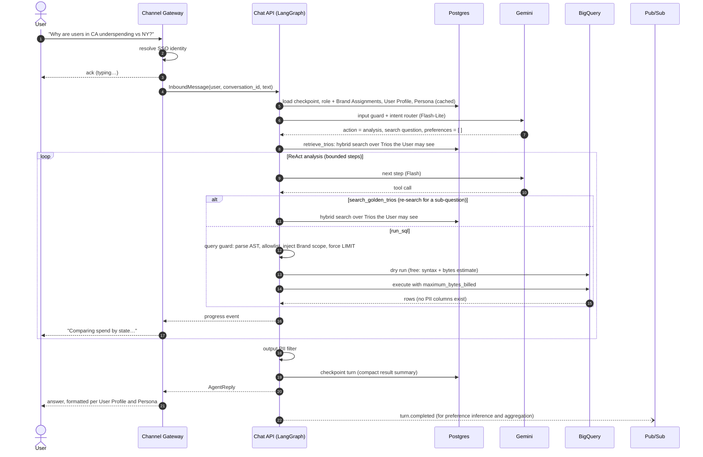
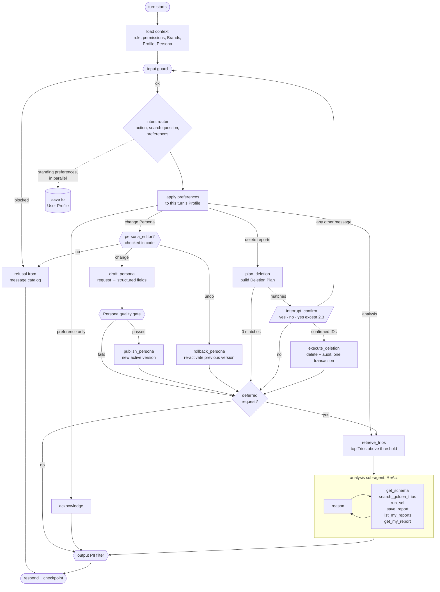

# 01 · Architecture

This section names every building block, says how the blocks talk to each other, and says where each kind of data lives and how it is handled. The hero diagram is in [00-overview](00-overview.md#architecture-at-a-glance). The reference deployment is GCP, but every block is a container or a managed service behind a port, so it can move ([ADR 0006](../adr/0006-ports-and-adapters.md)).

## Components

| Component | Runs on | Responsibility |
|---|---|---|
| **Channel Gateway** | Cloud Run service | One adapter per channel (Slack, Teams, web; the CLI in the prototype). Resolves the User through SSO, acknowledges the channel at once, forwards the turn to the Chat API and renders replies and confirmation prompts in each channel's own format. |
| **Chat API** | Cloud Run service (CPU always allocated) | Hosts the LangGraph agent. Loads the User context, runs the turn, streams progress and checkpoints the Conversation. Stateless: all state is in Postgres. |
| **Agent graph** | inside the Chat API | A fixed shell (input guard, intent router, output PII filter) around a ReAct analysis sub-agent with a fixed Golden Trio retrieval step in front of it, and a deterministic report-deletion branch ([ADR 0004](../adr/0004-hybrid-agent-graph.md), [ADR 0008](../adr/0008-trio-retrieval-is-a-fixed-step.md)). See [Agent graph](#agent-graph). |
| **Admin UI** | Cloud Run service behind IAP | Lets the CEO edit the Persona with preview, scheduling and rollback (the CEO can also change it in chat) ([09](09-persona-management.md)). Shows the Trio Candidate review queue to analysts ([02](02-hybrid-intelligence.md)). |
| **Background jobs** | Cloud Run jobs, triggered by Pub/Sub or Cloud Scheduler | Trio ingestion and nightly validation, entity extraction for Saved Reports, preference inference, Trio Candidate generation, weekly aggregation and synthetic canaries. Every job is idempotent, and each job type has a dead-letter topic. |
| **Gemini** | Vertex AI / Google AI Studio | Every model call goes through one model factory. Each step has its own model setting: router and guard on Flash-Lite, analysis on Flash, long reports on Pro ([10](10-stack-rationale.md)). |
| **BigQuery** | managed | The analytics data (`orders`, `order_items`, `products`, `users`). Read-only to us, owned by the data team. |
| **Cloud SQL Postgres + pgvector** | managed | All application state ([ADR 0002](../adr/0002-postgres-for-app-state.md)). See [Data stores](#where-data-lives-and-how-it-is-handled). |
| **GCS** | managed | The Golden Bucket landing zone (raw expert Trio files). Later also chart images referenced from Saved Reports. |
| **Observability backend** | self-hosted Phoenix or Langfuse, plus Cloud Monitoring and Logging | Receives OpenTelemetry spans from every node and tool ([08](08-observability.md)). |

**Shared platform.** Secret Manager holds API keys and DB credentials. Services reach Cloud SQL through a private VPC connector. IAP and SSO sit in front of the web channel and the Admin UI.

## How components communicate

| From → To | Style | Protocol and notes |
|---|---|---|
| Channel → Gateway | sync (ack), then async reply | The channel's webhook or socket. The Gateway acknowledges within the channel's deadline (a few seconds) and replies when the turn completes. |
| Gateway → Chat API | async per turn, streamed | Internal HTTPS with service-to-service IAM auth. The Chat API streams progress events ("Looking at Q1 orders…") and then the final `AgentReply` or `ConfirmationRequest`. |
| Chat API → Gemini | sync | HTTPS through the model factory, with timeouts, backoff on retryable errors, model fallback and a circuit breaker ([06](06-resilience.md)). |
| Chat API → BigQuery | sync | BigQuery client library. Every statement is dry-run first, then executed with `maximum_bytes_billed`. In production it runs on behalf of the User so row access policies apply ([03](03-safety-and-pii.md)). |
| Chat API → Postgres | sync | Cloud SQL connector with pooling: LangGraph checkpointer, reports, profiles, Persona (cached ~60 s). |
| Chat API → Pub/Sub | async, fire-and-forget | Domain events after commit: `report.saved`, `report.deleted`, `turn.completed`. The chat path never waits for a background job. |
| Pub/Sub → Background jobs | async, at-least-once | Push subscription, backoff, then a dead-letter topic and an alert after N attempts. Jobs dedupe on a key such as `report_id` or `trio_id + version`. |
| GCS → Trio ingestion | async | An object-finalize event triggers ingestion, plus a nightly sweep. |
| All services → Observability | async | OTLP export of spans, logs and metrics. |

**Why no queue on the chat path.** At ~1,000 questions a day with a few concurrent Users, a queue between the Gateway and the agent adds latency and moving parts for no benefit. A failed turn fails fast to the User with a reference ID; it is never parked for later replay, because a late answer to an old question confuses the User. The growth path is to put Cloud Tasks or Pub/Sub in that spot ([11](11-operations.md)).

## Request lifecycle: an analysis question

Self-correction inside `run_sql` (retries on SQL errors, one diagnosis on empty results) is detailed in [06](06-resilience.md). The delete flow, which pauses mid-turn for confirmation, is detailed in [04](04-destructive-ops.md).

## Agent graph

The outer shell has fixed edges, so the model cannot skip a safety step. Only the analysis node loops.

- **Hexagons** are safety layers enforced in code. The query guard is not a separate node; it sits inside `run_sql`, so no SQL reaches BigQuery without passing it.
- **The router returns three things in one Flash-Lite call:** the turn's single *action* (`analysis`, `delete reports`, `change Persona` or `preference only`); for `analysis`, a standalone *search question* that `retrieve_trios` uses, so a follow-up such as "and NY?" keeps its context ([ADR 0008](../adr/0008-trio-retrieval-is-a-fixed-step.md)); and a list of *preference statements*, each marked *standing* ("from now on, tables") or *this turn* ("this time, just bullets"). Preferences are not an alternative to an action; any message can carry both.
- **Preferences apply at once.** They are merged into this turn's in-memory User Profile before any branch formats an answer, so "tables from now on" already shapes the answer it arrived with. Standing preferences are also saved, in a parallel branch that adds no latency. This-turn preferences are never saved. A message that is only a preference gets a short acknowledgement ([05](05-learning-loop.md)).
- **One action per turn; delete and Persona changes go first.** If a message mixes a delete with another request ("delete my Q1 reports and make a new one"), the Deletion Plan is handled first and the agent says it will do the rest next. The other request is kept in graph state as a *deferred request* and runs once the delete is confirmed or declined. A deferred analysis request also passes through `retrieve_trios`, which then searches on the deferred request's own text. A Persona change mixed with a question works the same way, so the answer already uses the new tone. It is never dropped silently, and never run before the User has answered the confirmation.
- **Analysis covers** questions, report requests ("create a Q1 report") and questions about the data itself. Saving happens only through `save_report`, when the User explicitly asks.
- **Users' own Saved Reports.** `list_my_reports(filter?)` and `get_my_report(id)` let the agent find, open and compare a User's earlier reports ("compare with my report from last month"). Neither tool takes an author parameter: the Author is injected from the session by code, so a prompt cannot reach another User's reports. An opened report is labelled "data as of <saved date>" so old figures are not mistaken for current ones. Channels also offer a direct view with no model call: `/reports` in the CLI, and a "My reports" view or command in the web, Slack and Teams channels ([04](04-destructive-ops.md)).
- **Persona changes (CEO only).** "Make the reports warmer" or "undo the tone change" opens a fixed branch, never a tool of the analysis agent, because the change affects every User's answers. Code checks the `persona_editor` permission first; anyone else gets a refusal from the message catalog. A change is drafted into the Persona's structured fields, passes the automated quality gate and goes live at once, with no manual approval; a failure keeps the current version and says why. The direct edit (`/persona edit` in the CLI, the Admin UI form in production) enters the same branch at the permission check, skipping the router and the drafting step ([09](09-persona-management.md)).
- **Resuming after a pause.** The User's reply to a confirmation prompt is a new message. Anything other than a clear `yes`, `no` or `yes except …` cancels the plan and re-enters the graph at the input guard, never past it.
- **Errors.** A catch-all at the graph boundary maps any unclassified error to a plain-language message with a reference ID. The Conversation state is preserved, so the User can continue ([06](06-resilience.md)).
- **Extending.** A new capability (chart, email, web search) is a new in-process tool with a typed contract, behind a port, added to the analysis sub-agent's tool list. The shell does not change. Tools are not served over MCP today; MCP is a named growth option for capabilities that already ship as MCP servers, or for sharing governed data access with other agents ([ADR 0007](../adr/0007-in-process-tools-mcp-as-growth-option.md)). A tool with external side effects, such as sending email, reuses the same `interrupt()` confirmation pattern as deletion. A new channel is a new adapter in the Gateway, and a new model is a `.env` change.

## Conversation state

- A **Conversation** is one channel thread. Its `conversation_id` is a UUID created by the Chat API and used as the LangGraph `thread_id`. Saved Reports record it, so "delete the reports from this conversation" is an exact filter.
- The checkpointer stores graph state after every node, so a Chat API restart or a pause for confirmation resumes exactly where it stopped.
- **Long Conversations.** The last N turns stay verbatim, and older turns are folded into a running summary. Query results never enter the message history; only a compact result summary does (columns, row count, key figures). This keeps prompts small and cost bounded.

## Where data lives and how it is handled

| Data | Store | Written by | Retention | PII handling |
|---|---|---|---|---|
| Transaction data | BigQuery | Data team (daily load) | Data team's policy | PII columns are hidden by column-level security and absent from the agent's schema; rows are filtered by row access policies |
| Users, roles, permissions, Brand Assignments | Postgres | Admins; a sync job in production ([03](03-safety-and-pii.md#identity-and-roles)) | While the User is active | Internal IDs only; names and emails stay in the SSO provider |
| Conversation checkpoints | Postgres | Chat API | Assumed 90 days, like raw traces | Contains only what the User saw, which has already passed the PII filter |
| Saved Reports + extracted entities | Postgres | `save_report`; entity extraction job | Until the Author deletes them (hard delete) | Customers appear only as `user_id` |
| Deletion audit | Postgres | `execute_deletion` | Audit policy (assumed indefinite) | Metadata only: who, when, count, IDs, titles; never content |
| User Profiles | Postgres | Chat API (explicit), inference job (inferred) | Until the User deletes them | Notes pass the input guard and are visible to the User |
| Persona versions | Postgres | Chat API (CEO in chat) and Admin UI, after the quality gate | All versions kept, for rollback | None |
| Golden Trios (embeddings + payload) | Postgres (pgvector) | Ingestion job | Versioned; retired when broken | Figures stripped at ingestion ([ADR 0005](../adr/0005-golden-trios-teach-method-not-figures.md)) |
| Raw expert Trio files | GCS | Analysts | Versioned bucket | Restricted to the ingestion job and analysts |
| Trio Candidates | Postgres | Candidate job | Until approved or rejected; deleted with their source Saved Report | Anonymized, figures stripped |
| Interaction store (question, plan, SQL, result *shape*, feedback) | Postgres | Chat API via `turn.completed` | Raw 90 days; anonymized aggregates indefinitely | PII redacted on write; reads limited to the AI-ops team and logged |
| Traces | Observability backend (self-hosted) | All services | Raw 90 days | Self-hosted because spans carry business data; no result rows |

**Data the agent writes.** The agent never writes to BigQuery. Its only writes are its own state in Postgres: Saved Reports, audit rows, User Profiles, Trio Candidates and interaction and observability records. This matches the client's split: the data team owns ETL and modelling, and the agent only reads.

**PII path, end to end.** PII never enters the system through queries, because the columns are hidden and not in the queryable schema. It cannot leak through retrieval, because Trios are figure-stripped and Brand-tagged. It is caught on the way out by the output filter. It is redacted again before anything is stored for learning. The full layering is in [03](03-safety-and-pii.md).
