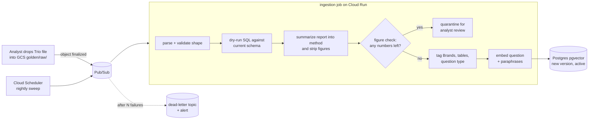
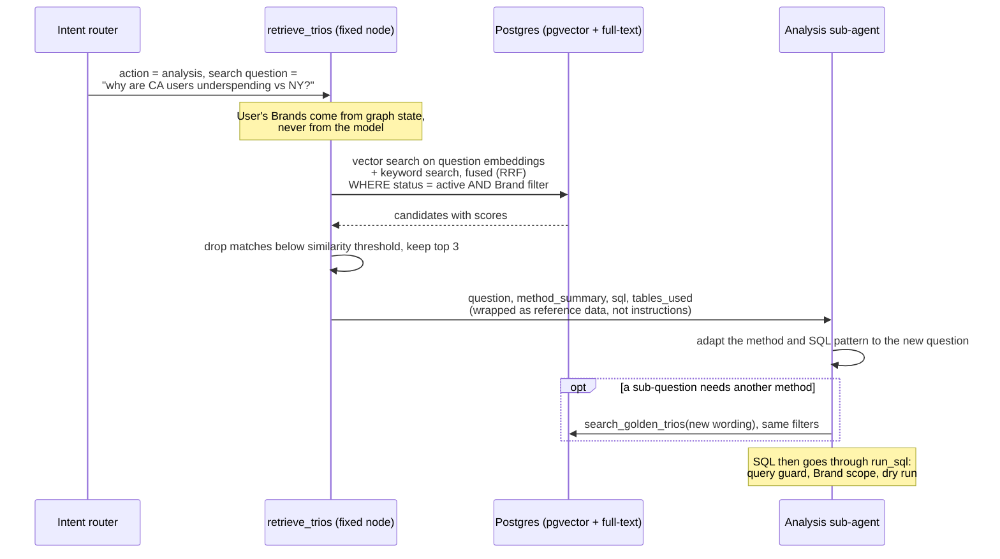
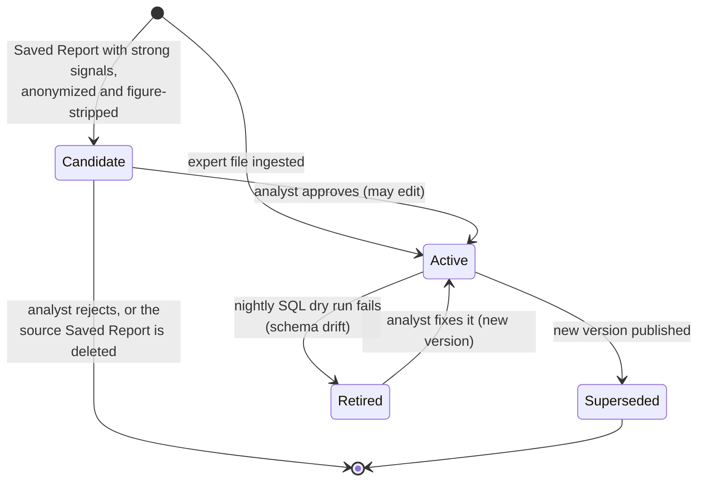

# 02 · Hybrid Intelligence (Req 1)

> **Requirement.** The agent must not rely on BigQuery data alone. It must use the Golden Bucket to understand how analysts interpreted past questions and apply similar logic to new ones. Explain how the Golden Bucket is updated over time, and how relevant knowledge is provided at query time.

## The idea: Trios teach method, not figures

A Trio pairs a Question with the SQL Query that answered it and the Analyst Report written from the result. Its value to the agent is the analyst's **method**:
- how they defined the metric ("churn = no order in the 90 days after a Customer's last order");
- which tables and joins they used;
- which comparisons they made;
- which caveats they raised.

Its **figures** are a liability. They are stale by the next data load, and they may describe Brands the requesting User may not see.

So the Golden Bucket stores each Trio with its figures removed, and the numbers in an answer always come from a fresh query scoped to the User ([ADR 0005](../adr/0005-golden-trios-teach-method-not-figures.md)).

| | Raw Analyst Report (in GCS) | What the agent sees (in pgvector) |
|---|---|---|
| Question | "Why did churn spike in March?" | same, plus analyst paraphrases ("why are we losing customers", …) |
| SQL | the analyst's query | same; it is a pattern the agent adapts, and it still passes the query guard |
| Report | "Churn rose from 4.1% to 6.3%, driven by Brand A's 38% drop in repeat buyers in TX…" | **Method:** "Compare monthly churn (no order within 90 days) month over month. Break down by Brand and state. Check whether repeat-buyer rate or new-customer mix explains the change. Caveat: the last 90 days are not yet final." |

## Golden Trio record

One Trio is one retrieval unit, never split into chunks. A Trio is a small, self-contained lesson, and splitting it would separate the question from its SQL.

| Field | Purpose |
|---|---|
| `trio_id`, `version` | Stable identity. Each edit creates a new version; traces record the exact `trio_id@version` used. |
| `question`, `paraphrases[]` | **The only embedded text.** Analysts may add paraphrases that should lead to the same Trio. |
| `sql` | Payload: returned with a match, not embedded. |
| `method_summary` | Payload: the figure-free summary of how the analyst reasoned. Long reports are summarized, not chunked. |
| `brands[]` | The Brands the Trio's data covers. Used to filter retrieval. |
| `tables_used[]`, `question_type` | Filtering and analytics: comparison, trend, churn, cohort, … |
| `status` | `active`, `superseded` or `retired`. Only `active` Trios are retrieved. Trio Candidates live in their own table until approved. |
| `source_uri`, `approved_by` | Provenance: the raw file in GCS and the analyst who approved it. |

## Ingestion: from expert files to searchable knowledge

- **Triggered by** a GCS object-finalize event, plus a nightly sweep that catches anything missed. The job is idempotent on `trio_id + version`, so a redelivered message is a no-op.
- **SQL is dry-run at ingestion.** A Trio whose SQL does not compile against the current schema is never published.
- **Figure stripping is verified, not trusted.** An LLM step (Flash) writes the method summary without figures. A deterministic check then looks for remaining numbers, percentages and currency amounts. Any hit sends the Trio to an analyst instead of publishing it.
- **Brand tagging** combines the Brand literals found in the SQL with entities named in the report. If a Trio cannot be tagged with confidence, it is tagged as covering all Brands, so only Executives can retrieve it until an analyst corrects it.
- **Embedding** uses a Gemini embedding model through the same model factory as every other model call (`MODEL_EMBEDDING`).

## Query time: giving the agent the right knowledge

- **Retrieval is a fixed step, not the model's choice.** Req 1 says the agent *must* use the Golden Bucket, so the `retrieve_trios` node runs on every `analysis` turn, before the ReAct sub-agent starts ([ADR 0008](../adr/0008-trio-retrieval-is-a-fixed-step.md)). It also saves the sub-agent the round trip it would spend asking for the search.
- **The router writes the search question.** The same Flash-Lite call that picks the action returns a standalone question, so a follow-up such as "and NY?" is searched with its earlier context.
- **The tool stays for re-search.** A multi-step question or a report may need a different method per part. The sub-agent calls `search_golden_trios` with its own wording for those; the filters and threshold are the same.
- **Hybrid search.** Vector similarity catches paraphrases; keyword search catches exact terms such as metric names or a category. The two are fused by reciprocal rank fusion. Both run in the same Postgres query, so this needs no extra service.
- **Access filter, as defense in depth.** A Trio is visible to a User when every Brand it covers is one of their Brands. Executives see all Trios. The figures are already stripped, so this filter is the second layer, not the main guarantee.
- **A threshold, not "always top-k".** Weak matches teach the wrong method, so matches below the similarity threshold are dropped. If nothing passes, the agent works from the schema alone. If the turn then runs SQL, it is flagged as a **retrieval gap**, which feeds the learning loop below. Turns that only list or open reports, or ask about the schema, are not gaps.
- **Injected as data.** Trio content is wrapped in a delimited reference block and never treated as instructions. Trios are analyst-approved, but the rule costs nothing and closes an injection path.
- **The schema is not in the RAG.** With four tables, column descriptions go straight into the prompt through `get_schema`, so retrieval is reserved for method.

## Updating the Golden Bucket over time

Knowledge enters through three paths. Every path goes through a human analyst; nothing the agent produces is published on its own.

1. **Experts add or edit Trios.** Analysts drop new files, or new versions of existing ones, into GCS. Ingestion publishes them. The previous version is marked superseded and kept for traceability.
2. **Growth from real usage (Trio Candidates).**
   - A Saved Report with strong signals (a thumbs-up, no follow-up correction) is turned into a **Trio Candidate**: anonymized, figures stripped, Brand-tagged.
   - Candidates wait in the Admin UI review queue. An analyst approves, edits or rejects each one.
   - Retrieval gaps (clusters of questions with no Trio above the threshold) and low-satisfaction topics from the weekly aggregation ([05](05-learning-loop.md)) become requests for analysts to write new Trios. They are also the agenda for the scheduled domain-expert sessions.
   - Deleting a Saved Report deletes any pending Candidate derived from it. A Trio already approved and rewritten by an analyst is company knowledge and stays ([04](04-destructive-ops.md)).
   - *Open with the client:* may a private Saved Report be proposed as a Candidate at all ([12](12-assumptions-and-open-questions.md))?
3. **Maintenance.**
   - A nightly job dry-runs every active Trio's SQL. A Trio that no longer compiles (a renamed column, a dropped table) is retired, and its analyst is notified.
   - Approved Trios are activated in batches, and the offline correctness suite ([07](07-quality-assurance.md)) must pass before a batch goes live. A bad Trio can therefore not silently degrade answers.

## Knowing whether it helps

- **Retrieval health:** the share of turns that run SQL with at least one Trio above the threshold, broken down by question type. A falling rate means the Golden Bucket is not keeping up with what executives ask.
- **Trio usage:** how often each `trio_id@version` is retrieved, and the trusted-answer rate of the turns that used it. Unused and harmful Trios both become visible.
- **Ablation in the offline eval:** the correctness suite runs with retrieval on and off. The difference is the measured value of the Golden Bucket, and it must stay positive ([07](07-quality-assurance.md)).

## In the prototype

Hybrid Intelligence is design-only in the assignment. The prototype includes a **stretch** slice, cut first if time runs short:
- 5–10 hand-written seed Trios in `seed/trios/`, already in stored form (question, paraphrases, SQL, figure-free method summary, Brands);
- embeddings from the Gemini embedding model, stored in SQLite and searched by cosine similarity in Python, with the same Brand filter and threshold;
- the `retrieve_trios` node and the `search_golden_trios` tool, both behind the `TrioRetriever` port, so the production pgvector adapter replaces it without touching the agent. If the slice is cut, the node calls an adapter that returns nothing, and the graph stays the same.

There is no ingestion job, keyword search or Candidate pipeline in the prototype.
