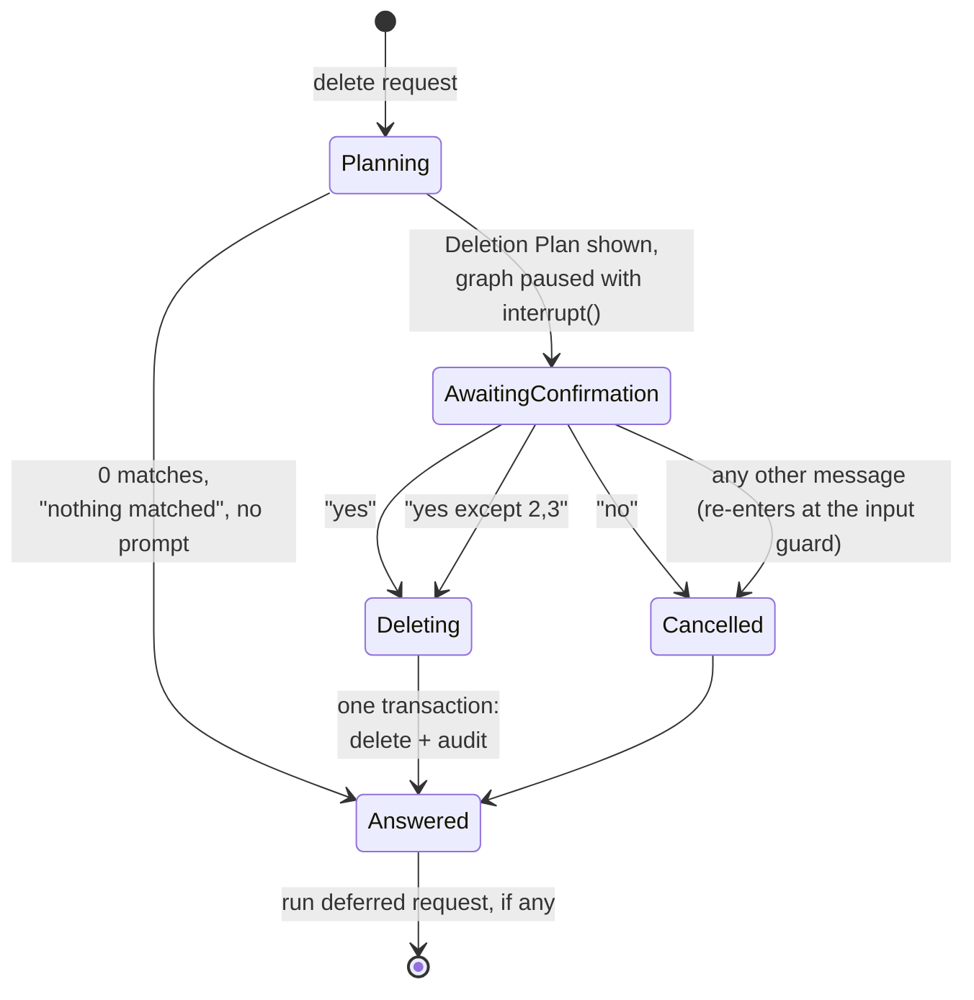

# 04 · High-Stakes Oversight: Saved Reports and deletion (Req 3)

> **Requirement.** The agent manages a Saved Reports library and must support requests such as "Delete all reports mentioning Client X" or "Delete all the reports we made in this conversation". These are destructive, so they need a strict confirmation flow before execution, without breaking the user experience. Users may delete only their own reports.

## Saved Reports

A **Saved Report** is the question, the SQL that answered it and the answer, saved because the User explicitly asked ("create a report for Q1", "save this"). Casual Q&A is never saved. A Saved Report is private to its **Author**: only the Author can see, change or delete it, and an Executive's wider data access does not extend to other Users' reports (confirmed by the client).

| Field | Why it is there |
|---|---|
| `report_id`, `author_id`, `conversation_id`, `created_at` | Identity, ownership, and exact filters such as "from this conversation". `conversation_id` is the LangGraph `thread_id`. |
| `title`, `question`, `sql` | What was asked and how it was answered. |
| `markdown` | The exact text the User saw, so reopening a report shows what they saved. |
| `structured` (JSONB) | Title, summary, insights, action items, period. Action items stay queryable, and each channel can render the report its own way. |
| `entities` (table `report_entities`) | Brands, categories, products and Customer IDs named in the report. Extracted after save, indexed for matching. |
| full-text index | The fallback for matching, and for reports whose entities are not extracted yet. |

Charts, when added, are files in object storage referenced from the report.

**Creating a report.** "Create a report for Q1 including insights and action items for Q2" runs the analysis sub-agent as usual: Golden Trios, scoped SQL, self-correction. Long reports may use the report model (`MODEL_REPORT`, Pro allowed). `save_report` runs the output PII filter on the report and then stores it; the reply passes the filter again on its way out. After commit, a `report.saved` event triggers entity extraction (Flash-Lite) in the background.

**Viewing reports.** `list_my_reports` and `get_my_report` let the agent find and open the User's own reports. Channels also offer a model-free view (`/reports` in the CLI). An opened report is labelled "data as of <saved date>" ([01](01-architecture.md#agent-graph)).

## Deletion: the model proposes a filter, code chooses the reports

The model never decides *which* reports are deleted. It only turns the request into a structured filter, and code runs that filter against the database, always restricted to the requesting User.

| Request | Filter produced | How it matches |
|---|---|---|
| "Delete all the reports we made in this conversation" | `conversation: current` | Exact: `conversation_id` of the current Conversation, injected by code |
| "Delete all reports mentioning Nike" | `entities: [Nike]` | Entity match in `report_entities` (case- and alias-normalized), with full-text search as the fallback |
| "Delete my reports from last week about churn" | `created: last week`, `topic: churn` | Date range on `created_at`, plus entity or full-text match |
| "Delete all my reports" | `all: true` | Every report of the User |

Every query adds `author_id = <session user>`. The model has no parameter for the Author, so no wording can reach another User's reports.

## The confirmation flow



1. **Build the Deletion Plan.** It is the exact list of matching reports, each with the reason it matched (`mentions: Nike, Adidas` or `made in this conversation`). The plan stores report **IDs**, not the filter, so a report saved after the plan was shown can never be deleted by it.
2. **Pause.** The graph stops with `interrupt()`. The plan and the paused state are checkpointed, so a restart in between loses nothing.
3. **The User answers** in one reply: `yes`, `no` or `yes except 2,3`. In Slack, Teams and web, the plan is a list of checkboxes with *Delete selected* and *Cancel* buttons.
4. **Only the confirmed IDs are deleted.**
5. **Anything else cancels.** Any other message cancels the plan, re-enters the graph at the input guard and is answered normally. Nothing is ever deleted on an ambiguous reply.
6. **Zero matches** means no prompt at all: the agent says nothing matched and suggests how to find the reports (for example, `/reports`).

**Large plans.** A plan with more than 20 reports shows the first 20, the total count and how to narrow the request. To delete them all, the User must confirm with the count ("yes, delete all 37"), so a broad request is never confirmed by reflex. A bare "yes" to a large plan gets one re-prompt asking for the count, rather than a cancel.

**Example (CLI):**

```text
you> delete all reports mentioning Nike
assistant> I found 3 of your reports that mention Nike:
  1. Q1 sales: Nike vs Adidas              (12 Mar)  mentions: Nike, Adidas
  2. Churn drivers in Women's Activewear   (20 Mar)  mentions: Nike
  3. Top customers, Nike, Q1               (2 Apr)   mentions: Nike
Delete them? Reply yes, no, or "yes except 2".
you> yes except 2
assistant> Deleted 2 reports (1 and 3). Kept "Churn drivers in Women's Activewear".
```

## Executing the deletion

One Postgres transaction, so either everything happens or nothing does:

1. Delete from `saved_reports` where `report_id` is in the confirmed IDs **and** `author_id` is the session User. The ownership check is repeated at execution time.
2. Remove the reports' entity rows (cascade).
3. Hard-delete any **pending** Trio Candidate derived from these reports. A Trio already approved and rewritten by an analyst is company knowledge and stays ([02](02-hybrid-intelligence.md)).
4. Insert one **audit row**: who, when, count, IDs and titles. It holds metadata only, never report content.

After commit, a `report.deleted` event cleans up related files, such as chart images in object storage.

- **Hard delete.** The client confirmed deletion is permanent, so there is no soft-delete flag or undo. The audit row is the record that it happened.
- **Idempotent.** The plan has an ID and is marked executed. A double click on *Delete selected*, or a replayed message, is a no-op. A button from an old, cancelled or executed plan is rejected with "this request has expired".
- **Already gone.** If a confirmed report was deleted in the meantime (for example, from another channel), the reply says so instead of failing.

## Strict, but not in the way

- **One reply** confirms: no modal dialogs, no second "are you sure".
- **The plan is the explanation.** The User sees exactly what will go and why, in plain language, and can drop items in the same reply.
- **Nothing to confirm, nothing asked.** Zero matches skip the prompt, and deleting never interrupts analysis.
- **Mixed requests keep moving.** In "Delete my Q1 reports and make a new one", the delete runs first, and the new report is made right after the User answers ([01](01-architecture.md#agent-graph)).

## Observability

Every plan and execution is traced: the filter produced, the plan size, the time to answer and the outcome (confirmed, partial, cancelled, expired). Metrics: confirm/cancel ratio, partial-confirmation rate, zero-match rate and plan size ([08](08-observability.md)). A rising cancel or partial rate means matching is too broad, and becomes a case for the eval set.

## In the prototype

Req 3 is a prototype requirement. The prototype implements:
- Saved Reports in SQLite behind the `ReportRepository` port, with SQLite FTS5 for full-text matching;
- `save_report`, `list_my_reports`, `get_my_report` and the `/reports` CLI command;
- entity extraction **at save time** (no background queue), so the full-text fallback is rarely needed;
- `plan_deletion` and `execute_deletion` with LangGraph `interrupt()` and the `yes` / `no` / `yes except N` reply in the CLI, including the large-plan and expired-plan rules;
- the delete-and-audit transaction;
- `pytest` tests for the Deletion Plan logic: exact Conversation filter, entity matching, Author isolation, partial confirmation, cancel on any other message, idempotent execution.
