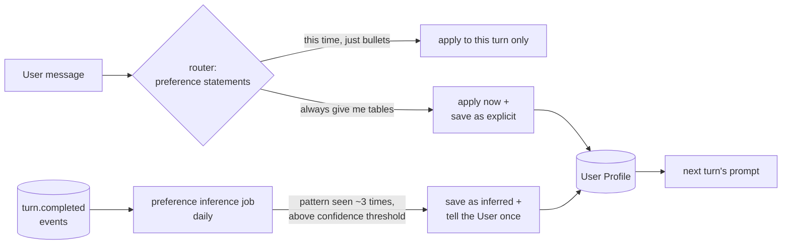
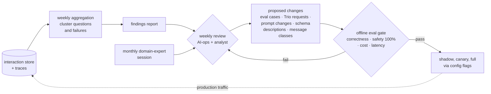

# 05 · Continuous Improvement: the learning loop (Req 4)

> **Requirement.** At the **user level**, the agent should remember that User A prefers tables while User B prefers bullet points, and learn preferences over time (depth of analysis, charts or text). At the **system level**, it should learn from past interactions and improve itself.

## Two loops at two speeds

| | User level | System level |
|---|---|---|
| **Learns** | How *one* User likes answers presented | What the *whole system* gets wrong or lacks |
| **Speed** | Immediately (explicit) or within a day (inferred) | Weekly review cycle |
| **Changes** | That User's Profile | Prompts, Golden Trios, schema descriptions, eval set, message catalog |
| **Who approves** | The User (they can see and undo it) | Humans, plus the eval gate. Never self-modifying in production. |

User preferences are low-risk and personal, so they apply at once. System changes affect every User and every answer, so they go through people and tests.

## User level: the User Profile

### What is stored

1. **Core fields** (typed): `format` (table, bullets, prose), `depth` (headline, standard, deep dive), `charts` (never, when helpful, always), `language`.
2. **Extensible attributes** (JSONB): new preference kinds without a migration, such as `currency_display` or `default_period`.
3. **Notes**: a capped list of about 20 short free-text preferences ("always compare with last year"). They are length-limited, pass the input guard, are injected as data and never as instructions, and the User can see and delete them.

Each value records its **source** (explicit or inferred), its confidence and when it was last confirmed.

### How it is learned

- **Explicit statements apply immediately.** The router extracts them from any message, alongside its action ([01](01-architecture.md#agent-graph)). "This time" applies to the current answer only; "always" or "from now on" is saved.
- **Patterns are inferred, slowly and visibly.** A daily job reads the turn events. When a pattern repeats about three times above a confidence threshold, it saves an inferred preference. Examples: the User asks to "turn that into a table" after answers; they often follow up with "why?" (prefers deeper analysis); they never open charts. The agent then says so once ("I've noticed you prefer tables, so I'll use them from now on. Say 'stop' to undo."), so learning is never a surprise.
- **Explicit always beats inferred.** An inferred value never overwrites something the User said.
- **The schema evolves from use.** A periodic aggregation looks for note types that recur across Users and promotes them into attributes or core fields, so the structured profile grows where people actually need it.

### How it is used

The Profile is loaded with the User context and injected as a "User preferences" data block for the steps that write answers. Precedence, from strongest to weakest:

1. **Locked safety rules** (cannot be overridden by anything below);
2. **this-turn** instructions;
3. **explicit** standing preferences;
4. **inferred** preferences;
5. **Persona** defaults.

The Persona ([09](09-persona-management.md)) governs company tone and the sections every report must contain. The Profile governs presentation: format, depth, charts. A User who prefers bullets still gets the Persona's action items, as bullets.

**The User is in control.** "What do you know about my preferences?" (or `/profile` in the CLI) shows the Profile in plain language. Any value or note can be removed, and "reset my preferences" clears it.

## System level: learning from every interaction

### Raw material: the interaction store

Every turn is recorded: the question, the plan, the SQL, retries and guard decisions, the result *shape* (never rows), the answer, feedback and the trace ID. PII is redacted on write. Raw records are kept 90 days and anonymized aggregates indefinitely. Raw access is limited to the AI-ops team, and every read is logged.

**Signals of quality:**
- explicit: thumbs up or down, and CSAT in the web channel;
- implicit: rephrasing the same question, abandoning the Conversation, corrections ("that's wrong", "I meant last quarter");
- technical: SQL retries, exhausted self-correction, empty results, retrieval gaps ([02](02-hybrid-intelligence.md)), guard blocks later reversed by the User, unclassified errors.

### The cycle

The findings report covers new topics, recurring SQL errors, low-satisfaction areas, retrieval gaps and unclassified errors.

- **Every real failure becomes a test.** A failure found in review is added to the offline eval set before it is fixed, so it can never quietly come back ([07](07-quality-assurance.md)).
- **Knowledge gaps go to analysts.** Clusters of questions with no good Trio, or with low satisfaction, become requests for new Trios, and Trio Candidates from well-received Saved Reports enter the analyst review queue ([02](02-hybrid-intelligence.md)).
- **Recurring SQL errors usually mean the schema is unclear.** If the model keeps mixing up `orders.created_at` and `order_items.shipped_at`, the fix is a clearer column description in `get_schema`. Such fixes are cheap, safe and measurable.
- **Domain-expert sessions** bring what logs cannot show: business context, new priorities and definitions such as how the company really defines churn.
- **Shipping a change** follows the same promotion path as the architecture ([ADR 0004](../adr/0004-hybrid-agent-graph.md)): the offline eval against the current version, then shadow traffic, a canary percentage and full rollout, all controlled by configuration. Any change can be rolled back by configuration.

**Why not let the agent improve itself automatically?** Automatic prompt or knowledge rewriting in production can drift, encode one User's mistakes for everyone, or open a path for poisoning through crafted conversations. Keeping humans and the eval gate in the loop makes every change explainable and reversible, at the cost of a weekly rather than continuous cadence. At ~1,000 questions a day, a weekly cycle has plenty of data.

## Knowing that it is working

- **User level:** the *preference override rate*, which is how often a User corrects the format or depth after the Profile was applied. It should fall over time per User.
- **System level:** the trends of the trusted-answer rate, rephrase rate and first-try SQL success after each shipped change, and the share of review findings closed within two cycles ([08](08-observability.md)).

## Privacy

- The User Profile is the User's: visible, editable and deletable by them.
- The interaction store is PII-redacted, retention-limited and access-logged.
- *Open with the client* ([12](12-assumptions-and-open-questions.md)): may a private Saved Report be proposed as a Trio Candidate, and is 90-day raw retention acceptable?

## In the prototype

Continuous Improvement is design-only in the assignment. The prototype lays the groundwork and adds one **stretch** slice, after Golden Trios:

- **Already in the prototype:** the router extracts preference statements on every turn, and every turn is written to the JSONL traces, which are the raw material for the system loop.
- **Stretch:** standing preferences are saved as **notes** in SQLite behind the `ProfileStore` port and injected into the next turn's prompt; `/profile` shows and clears them.
- **Not in the prototype:** inference, aggregation and the review tooling.
