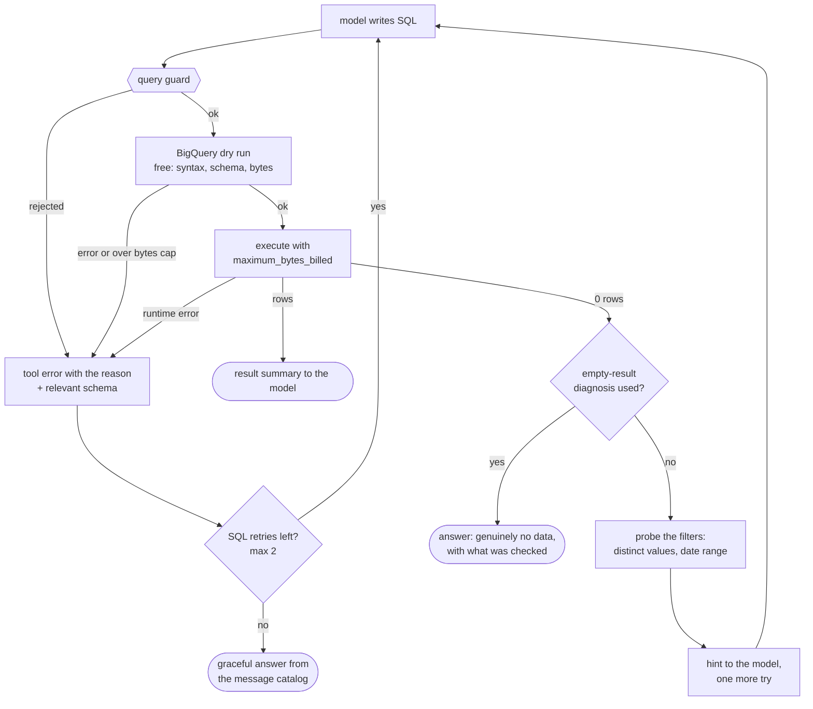
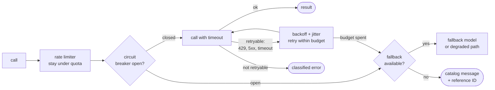

# 06 · Resilience & graceful error handling (Req 5)

> **Requirement.** Detect SQL syntax errors and empty results and try to self-correct before giving up. Do it without crashing the user interface and without inflating costs. Be resilient to API and third-party failures and downtime.

## Four kinds of failure, four responses

Every error the system meets is sorted into one of four classes. Each class has one response, so nothing is handled ad hoc.

| Class | Examples | Response | Who sees it |
|---|---|---|---|
| **Self-correctable** | SQL syntax or schema error, query-guard rejection, bytes cap exceeded, empty result | Feed the error back to the model and let it fix the SQL, within a bounded budget | Nobody, unless the budget runs out |
| **Transient** | Gemini 429 or 5xx, BigQuery `backendError`, timeouts | Retry with backoff, then fall back to another model, within the turn's budget | Nobody, unless every option fails |
| **Permanent for this request** | Brand out of scope, PII request, per-User quota reached | No retry. A plain-language answer from the message catalog, with a next step. | The User, at once |
| **Unclassified** | Any exception nothing above recognizes | Catch-all at the graph boundary: generic message plus reference ID, full error traced and alerted | The User, at once; AI-ops through the alert |

The rest of this section explains each response, then how all of them stay cheap and invisible to the UI.

## SQL self-correction

Every SQL statement goes through `run_sql`, and the loop below runs inside it. The counters live in graph state, so the cost of a question is bounded and visible in its trace.

1. **Dry run first.** A BigQuery dry run costs nothing. It catches syntax and schema errors and returns the bytes the query would scan. A query over the bytes cap is rejected here, before it costs anything.
2. **Error → retry, at most twice.** The error message and the schema of the tables involved go back to the model as the tool result, and it rewrites the query. Guard rejections, dry-run errors, runtime errors (for example, division by zero) and bytes-cap rejections all share this budget. A bytes-cap rejection carries a hint: narrow the date range or aggregate earlier.
3. **Empty result → diagnose once.** An empty result is often a wrong filter, not a real answer: `state = 'California'` when the data says `'CA'`, or "last month" when the last data load was earlier. One diagnosis step probes the query's filters, then the model gets one more try.
   - **The probe is code, not a model call.** The query guard has already parsed the SQL, so code reads the filter literals from the AST and runs small, scoped probe queries through the same guard: the closest distinct values of each filtered column and the table's date range. The findings go to the model as a hint ("`state` has 'CA', not 'California'; data ends on 3 Nov").
   - **Empty can be the right answer.** If the filters are valid and the result is still empty, the agent says so plainly ("No orders for Brand X in Texas in October"), with what it checked. It does not keep searching for rows that do not exist.
4. **Budget exhausted → graceful answer.** The agent explains in plain language what it tried, shares any findings from queries that did succeed earlier in the turn, and suggests a rephrasing. The UI never sees an exception.

## Third-party failures

Every external call goes through the adapter behind its port ([ADR 0006](../adr/0006-ports-and-adapters.md)), and every adapter wraps the call the same way:

- **Timeouts on every call.** Nothing waits forever. Starting values are configuration, tuned from trace data: about 10 s for Flash-Lite calls, 60 s for Flash and Pro, 60 s for a BigQuery job, 5 s for Postgres.
- **Backoff with jitter, for retryable errors only** (`tenacity`): 429, 5xx and timeouts, honoring `Retry-After`, up to 3 attempts. A 400 or a permission error is never retried.
- **Only idempotent calls are retried.** Model calls, dry runs and queries are safe to repeat. Writes are made idempotent instead: `save_report` dedupes on Conversation and turn, and `execute_deletion` on the plan ID ([04](04-destructive-ops.md)).
- **A circuit breaker per dependency.** After repeated failures (for example, 5 in 30 s), the breaker opens and calls fail fast for a cool-down, then one probe call tests recovery. When BigQuery is down, the User gets an answer in a second, not after three timeouts.
- **Client-side rate limiting.** A token bucket per model, sized from the configured quota (the Gemini free tier in the prototype), makes calls wait briefly instead of hitting 429s. If the wait would exceed the turn's budget, the turn gets the "busy" message instead.

### What happens when each dependency fails

| Dependency | Fallback | What the User experiences |
|---|---|---|
| **Gemini** (analysis, report) | Flash → Flash-Lite. Production adds a second Vertex AI region, then a second provider, each a setting such as `MODEL_ANALYST_FALLBACK` resolved by the model factory. | The answer arrives, possibly plainer. The trace marks the fallback. |
| **Gemini** (input guard, router) | The same fallback chain. If every model is down, the turn stops: **safety steps fail closed**, they are never skipped. | "I can't take questions right now. Please try again in a few minutes." |
| **BigQuery** | None for data: no stale copy is served as fresh. Everything that does not need BigQuery keeps working: listing, opening and deleting Saved Reports, and preferences. | "The sales data is unavailable right now. You can still open your saved reports." |
| **Postgres** | None. Without it there is no identity, no Brand Assignments and no checkpoint, so the turn fails closed. Cloud SQL runs in high-availability mode ([11](11-operations.md)). | "I'm unavailable right now. Please try again shortly." |
| **Golden Trio search** | The agent continues from the schema alone; the turn is flagged as degraded. | Nothing visible; the answer may be less informed. |
| **Persona store** | The last cached version, or the bundled default Persona on a cold start ([09](09-persona-management.md)). | Nothing visible. |
| **Output PII filter (Sensitive Data Protection)** | The regex detectors used in the prototype stay in production as the fallback. **The filter is never skipped.** | Nothing visible. |
| **Pub/Sub** (events after commit) | Publishing is retried. If it still fails, nightly sweeps redo the missed work, for example extracting entities for reports that have none; the full-text fallback covers matching meanwhile. | Nothing visible. |
| **Observability backend** | Spans are exported asynchronously in batches and dropped on overflow. Tracing never blocks or fails a turn; errors still reach Cloud Logging. | Nothing visible. |

**Fallback models must earn their place.** A model is added to a fallback chain only after it passes the offline eval suites for that step ([07](07-quality-assurance.md)), so a fallback answer is a cheaper answer, not an unchecked one. Fallback activations are a reliability metric ([08](08-observability.md)).

Background jobs have their own resilience: at-least-once delivery, idempotent handlers, and a dead-letter topic with an alert per job type ([11](11-operations.md)).

## Never crashing the UI

- **Every turn ends in a reply.** A catch-all at the graph boundary turns any error into a message from the catalog. The CLI loop catches everything, so a failed turn never ends the session.
- **The Gateway has its own deadline.** If the Chat API does not answer in time, the Gateway sends the "taking too long" message itself, so a channel never waits in silence.
- **Progress keeps long turns from looking stuck.** Retries and fallbacks emit progress events ("Checking that filter again…"), streamed to the channel ([01](01-architecture.md#how-components-communicate)).
- **The Conversation survives.** State is checkpointed after every node, so after a failure the User simply continues. A failed turn is never replayed later, because a late answer to an old question confuses the User.

### The message catalog

User-facing messages never contain service names, error codes or stack traces. Each failure class has one plain-language message, and every message offers a next step. The technical detail goes to the trace; the message carries a short **reference ID** (the trace ID) for support. The catalog's wording lives in the Persona layer, so its tone follows the Persona ([09](09-persona-management.md)).

| Class | Message (example wording) |
|---|---|
| Data source down | "The sales data is unavailable right now. You can still open your saved reports, or ask again in a few minutes." |
| Model busy or down | "I'm a bit overloaded. Please ask again in a minute." |
| Self-correction exhausted | "I couldn't build a reliable query for that. I tried filtering by state and by month. Could you rephrase, for example with a specific period?" |
| Query too large | "That question needs more data than one query may scan. Try a shorter period or a specific Brand." |
| Out of Brand scope | "You can analyze Nike and Adidas. I can't show data for Puma." |
| PII request | "I can't show personal details, but I can show your top customers by ID with their total spend and state." |
| Daily quota reached | "You've reached today's analysis limit. It resets at midnight." |
| Unclassified | "Something went wrong on my side. I've logged it (ref: `a1b2c3`). Try rephrasing or ask again shortly." |

**Unknown failures get a class over time.** An unclassified error is traced in full, tagged `unclassified` and alerted on every occurrence. The weekly review looks at them, and a recurring one gets its own class and message ([05](05-learning-loop.md)).

## Without inflating costs

Resilience must not become a way to spend money. Every loop has a ceiling:

| Cost risk | Ceiling |
|---|---|
| A broken query scans data on every retry | The dry run is free and catches most errors before execution |
| A huge scan | `maximum_bytes_billed` on every query; rejection at the dry run |
| Endless self-correction | At most 2 SQL retries and 1 empty-result diagnosis per question, counted in graph state |
| A ReAct loop that never converges | A cap on analysis steps per turn, and a turn deadline |
| Retries multiplying model calls | Retries only on retryable errors, within a per-turn budget; the breaker stops retry storms |
| Diagnosis costing a model call | The empty-result probe is code reading the AST, not a model call |
| Big results re-sent on every retry | Only a compact result summary enters the context, never the rows ([01](01-architecture.md#conversation-state)) |
| Repeated questions | Result cache per question and scope until the next data load, plus BigQuery's own cache ([11](11-operations.md)) |
| One heavy User | Per-User daily quotas on tokens and bytes; a global daily spend cap with an alert at 80% ([11](11-operations.md)) |

Retries per question, bytes per question and cost per successful answer are tracked metrics, so a change that makes self-correction more expensive is visible in the next review ([08](08-observability.md)).

## In the prototype

Resilience is a prototype requirement. The prototype implements:
- the full self-correction loop in `run_sql`: query guard, dry run, bytes cap, 2 SQL retries, the empty-result probe and one more try, then the graceful answer;
- timeouts and `tenacity` backoff on Gemini and BigQuery calls, for retryable errors only;
- model fallback Flash → Flash-Lite through the model factory;
- an in-process circuit breaker per dependency and a token-bucket rate limiter sized for the Gemini free tier;
- the message catalog with reference IDs, the graph-boundary catch-all and a CLI loop that never dies;
- `pytest` tests that inject failures through fake adapters: a syntax error, an empty result with a wrong literal, a guard rejection, a 429 burst, a model outage, BigQuery down.

Not in the prototype: a second region or provider, the Gateway deadline, result caching, per-User quotas and the spend cap. Of the cost controls, only the per-query bytes cap is enforced.
