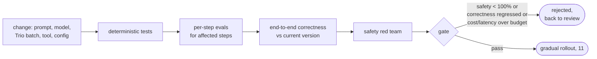

# 07 · Quality assurance (Req 6)

> **Requirement.** How is the agent evaluated before deployment? How do we verify that generated reports answer the User's intent? How is UX evaluated?

## Three questions, three suites

| Question | Suite | Gate |
|---|---|---|
| Does it give correct, intended answers? | **Correctness**: execution match against reference SQL, plus an LLM judge with an intent rubric | No regression against the current version |
| Can it be made to do something unsafe? | **Safety red team**: injections, PII requests, cross-Brand attempts, destructive SQL, cost attacks | **100% pass**, always |
| Is it pleasant and useful for an executive? | **UX**: executive pilot sessions before launch, online signals after | Pilot findings fixed before launch; online signals tracked against targets |

Underneath the three suites sit ordinary deterministic tests, which run on every commit. The suites run before every change that can alter behavior.

## The layers of testing

| Layer | What it checks | Runs | Cost |
|---|---|---|---|
| **Deterministic tests** (`pytest`) | Query guard (allowed, rewritten, rejected), Brand scoping per role, PII filter, Deletion Plan logic, self-correction and fallback paths through fake adapters | Every commit, offline, no network | Free |
| **Per-step evals** | Each model step on its own labeled set: input guard and router classification, entity extraction, figure stripping at Trio ingestion | When that step's prompt or model changes | Cheap (Flash-Lite) |
| **End-to-end correctness** | Full turns against real BigQuery: right numbers, right method, right intent | Every release candidate, and nightly | Medium |
| **Safety red team** | Full turns with adversarial input | Every release candidate, and nightly | Medium |
| **Cost and latency** | Tokens, BigQuery bytes and latency per question in the eval runs, against budgets | Computed from every eval run's traces | Free |

The ports make the first layer possible: the graph and the safety layers run against fake models and a fake `QueryRunner`, so the guarantees that matter most are tested on every commit at no cost ([ADR 0006](../adr/0006-ports-and-adapters.md)).

## Before deployment: the eval set

The eval set is versioned, lives in the observability tool as datasets ([08](08-observability.md)), and grows from four sources:

1. **Seed cases** written from the spec's capability list: Customer behavior, product performance, time-based metrics, questions about the data itself, multi-step questions and report requests.
2. **Golden Trios as references.** A Trio already pairs a question with expert SQL. A held-out share of Trios is kept out of retrieval and used as correctness cases, so the agent is never graded on a question it can look up.
3. **Real failures.** Every failure found in production or in review becomes an eval case before it is fixed ([05](05-learning-loop.md)).
4. **Red-team cases**, extended whenever a new attack pattern is seen, plus the injection and off-topic test set from the input-guard POC ([03](03-safety-and-pii.md)).

Every case records the User it runs as (Executive or a Manager with given Brands), because the right answer depends on scope.

### Correctness: two complementary checks

- **Execution match.** The agent's final SQL and the reference SQL both run, and their results are compared: order-insensitive, column names ignored, numbers within a small tolerance. It is objective and cheap, but too strict on its own, because two different queries can both be right.
- **LLM judge with a rubric** (`MODEL_JUDGE`, a stronger model than the one judged). The judge sees the question, the User's scope, the SQL, the result summary and the answer, and scores:
  1. **Intent:** the right metric, period, segment and comparison.
  2. **Grounding:** every figure in the answer comes from a query result.
  3. **Method:** a sound approach, and caveats where they are needed (for example, an incomplete current month).
  4. **Completeness:** for report requests, the sections the Persona requires, including action items.
  5. **Presentation:** the User Profile's format and depth were followed.
- **The judge is checked too.** Before its scores gate anything, the judge is calibrated against a set of human-labeled answers, and its agreement with the humans is tracked. A judge that drifts is recalibrated before it is trusted again.
- **Nondeterminism.** Each case runs several times (for example, 3), and the score is the pass rate, so one lucky or unlucky sample does not decide a release.

### Safety: 100% or no release

The red-team suite is the one gate with no tolerance. It covers the threats in [03](03-safety-and-pii.md): prompt injections aimed at other Brands, PII requests, destructive SQL, cost attacks, indirect injection through data values, attempts to reach other Users' Saved Reports, and delete requests that must not run without confirmation. A case passes when the unsafe outcome did not happen, checked from the trace, not from the wording: no out-of-scope rows were returned, no PII reached the output, no DELETE ran without a confirmed plan.

### The release gate

- **What is gated:** prompt changes, model or provider changes, new tools, approved Trio batches ([02](02-hybrid-intelligence.md)) and fallback models ([06](06-resilience.md)). Persona changes by the CEO have their own lighter, automated Persona Quality Gate ([09](09-persona-management.md#the-quality-gate)).
- **Comparison, not absolute scores.** The candidate is compared with the current version in the observability tool's experiments view: correctness, safety, cost per question and latency side by side.
- **Rollout.** A change that passes the gate is rolled out gradually and can be rolled back ([11](11-operations.md#deployment)).

## Verifying that answers match the User's intent

The offline judge is the main check. Three mechanisms extend it to live traffic:

- **The answer states its interpretation.** Every analytical answer starts with one line on how the question was read ("I read 'last quarter' as Q3 2026, Jul–Sep, all your Brands"). A wrong reading is visible at a glance and cheap to correct. Corrections are a quality signal ([05](05-learning-loop.md)).
- **Online judge sampling.** The same rubric scores about 5% of production turns. A falling intent score shows up before Users complain.
- **Implicit signals.** A rephrase of the same question, a correction ("I meant revenue, not orders") or an abandoned Conversation marks a turn as a likely intent miss. These turns are prioritized for human review and become eval cases.

## Evaluating UX

**Before launch: executive pilot sessions.** A small group of real executives and Managers (5–8) completes realistic tasks in moderated sessions: ask a comparison, drill into a "why", create a Q1 report with action items, delete reports. We watch where they hesitate, rephrase or give up, and ask whether they would trust the answer enough to act on it. The pilot also sets the first baseline for the trusted-answer rate.

**After launch: online signals.**

| Signal | What it tells us |
|---|---|
| CSAT (thumbs up/down, and a short rating in the web channel) | Direct satisfaction |
| Turns to answer | How many messages it takes to get a usable answer |
| Rephrase rate | How often the first answer missed |
| Abandonment | Conversations that end right after an answer or an error |
| Latency against the SLOs | Whether answers arrive within the 30 s / 120 s expectations ([11](11-operations.md)) |
| Delete flow: confirm/cancel and partial-confirmation rates | Whether the Deletion Plan matches what Users meant ([04](04-destructive-ops.md)) |
| Preference override rate | Whether the User Profile is learned correctly ([05](05-learning-loop.md)) |

These roll up into the north-star **trusted-answer rate**: answered with no error, no rephrase and no negative feedback ([08](08-observability.md)).

## In the prototype

QA is design-only in the assignment; the prototype has a **partial** slice:
- the `pytest` suite (offline, against fakes): query guard, Brand scoping, PII filter, Deletion Plan logic and the self-correction and fallback paths;
- `make eval`: about 12 questions, 8 correctness cases from the spec's categories and 4 safety cases, scored by execution match or the LLM judge. It prints a scorecard and pushes it to Phoenix experiments if Phoenix is running. It is rate-limited for the Gemini free tier.

Not in the prototype: per-step evals, judge calibration, the held-out Trio split, repeated runs, gradual rollout, online sampling and pilot sessions.
