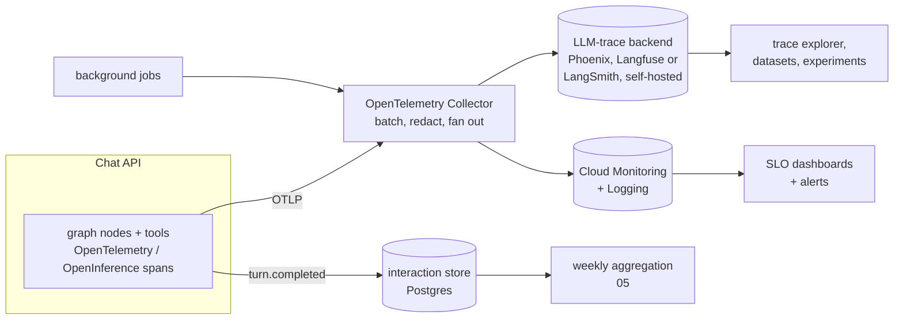
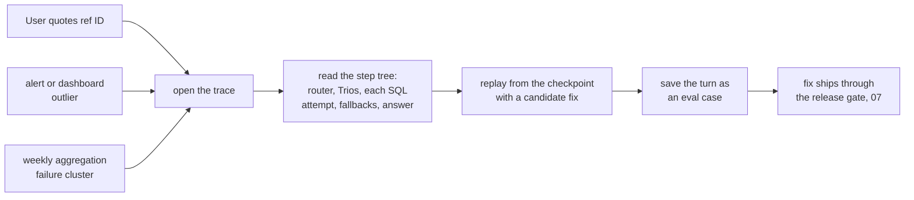

# 08 · Observability (Req 7)

> **Requirement.** We need to know **when** the agent is failing and **why**. Define the metrics tracked at the agent level, and explain how deep-dive analysis and debugging are supported (understanding the message exchange and what went wrong).

## When and why: two instruments

| Question | Instrument | Answers |
|---|---|---|
| **When** is it failing? | Metrics, SLOs, alerts, synthetic canaries, online evals | "The first-try SQL success rate dropped from 82% to 61% since Tuesday's prompt change." |
| **Why** is it failing? | One trace per turn, with a span for every node and tool call | "The model filters `orders.created_at` where the question meant `order_items.shipped_at`; both retries repeated the mistake." |

Both come from the same instrumentation, so every number on a dashboard can be opened down to the turns behind it.

## Instrumentation



- **Vendor-neutral.** Every node and tool emits OpenTelemetry spans with OpenInference conventions for LLM calls. The backend is a deployment choice, not a code change, behind the `Tracer` port ([ADR 0006](../adr/0006-ports-and-adapters.md)).
- **An OpenTelemetry Collector** batches spans, applies a second PII-redaction pass and sends LLM traces to the trace backend and infrastructure metrics to Cloud Monitoring. Exporting never blocks a turn ([06](06-resilience.md)).
- **Self-hosted trace backend.** Spans carry business data (questions, SQL, answers), so they stay in our project. Three backends fit: **Phoenix** is the lightest to run; **Langfuse** is stronger on prompt management and user analytics; **LangSmith** fits LangGraph most closely (graph-aware trace views, datasets and experiments), but self-hosting it is an Enterprise-plan add-on, and its SaaS version would send business data outside our project, which needs the client's approval. The choice is a deployment setting behind the `Tracer` port.

### What one trace holds

A trace is one turn. Traces of the same Conversation are grouped by `conversation_id`, so the whole message exchange can be read in order.

| Level | Attributes |
|---|---|
| **Turn** (root span) | trace ID (= the reference ID shown to the User), `conversation_id`, internal User ID (never a name or email), role, channel, action from the router, Persona version, User Profile snapshot, retrieval gap flag (set when the turn ran SQL with no Trio above the threshold), outcome, error class |
| **Model call** | step (`router`, `analyst`, …), model and provider, fallback used, prompt and completion tokens, cost, latency |
| **`run_sql`** | the SQL the model wrote, the SQL after the guard's rewrite, guard decision and reason, dry-run bytes, bytes billed, row count, attempt number, error, empty-result probe findings |
| **Trio retrieval** (`retrieve_trios` node, `search_golden_trios` tool) | which one ran, the search question or query, returned `trio_id@version` and scores, matches dropped by the threshold |
| **Deletion** | filter produced, plan ID and size, outcome (confirmed, partial, cancelled, expired) |
| **Persona change** | path (chat or direct edit), permission result, gate result per check, version before and after, or rollback target |
| **Output filter** | detector hits and redactions (types only, never the redacted value) |

**Never in a trace:** result rows and PII. The model sees only a compact result summary, and the trace stores the same summary ([01](01-architecture.md#conversation-state)).

## Metrics

Every metric is broken down **by intent and by node**, so a regression points to where it happens.

| Family | Metrics |
|---|---|
| **North star** | **Trusted-answer rate**: answered with no error, no rephrase and no negative feedback |
| **Quality** | Task success, first-try SQL success, self-correction success, empty-result rate, rephrase rate, online judge score ([07](07-quality-assurance.md)) |
| **Safety** | Input-guard blocks by category, query-guard rejections by reason, out-of-scope Brand requests, output PII-filter hits (target 0), delete confirm/cancel ratio |
| **Cost** | Tokens and $ per question, BigQuery bytes per question, retries per question, **cost per successful answer** |
| **Reliability** | p50/p95 latency per turn and per node, LLM and BigQuery error rates, fallback activations, circuit-breaker state, unclassified errors |
| **Knowledge** | Retrieval health (share of turns that run SQL with a Trio above the threshold), usage and trusted-answer rate per `trio_id@version` ([02](02-hybrid-intelligence.md)) |
| **Learning** | Preference override rate, share of review findings closed within two cycles ([05](05-learning-loop.md)) |
| **Persona** | Changes by path, gate rejections by check, rollbacks; trusted-answer rate and online judge presentation score per Persona version ([09](09-persona-management.md)) |
| **Deletion** | Partial-confirmation rate, zero-match rate, plan size ([04](04-destructive-ops.md)) |

Cost is measured per *successful* answer, not per question, so a change that saves tokens by failing more often does not look like a saving.

## Knowing *when*: SLOs, alerts and probes

The SLOs are defined in [11](11-operations.md): p95 latency of 30 s for questions and 120 s for reports, 99.5% availability in business hours, a trusted-answer rate of at least 85%, and zero PII leaks and zero out-of-scope answers.

| Alert | Fires when | Severity |
|---|---|---|
| PII in output | Any output-filter hit | Page immediately, at any hour |
| Out-of-scope answer | Any red-team canary or trace check finds rows outside the User's Brands | Page immediately |
| Error-budget burn | Latency or availability budget burning fast (multi-window burn rate) | Page in business hours |
| Canary failure | A synthetic canary fails twice in a row | Page in business hours |
| Quality drop | Trusted-answer rate or online judge score falls below target over a day | Ticket |
| Unclassified error | Any occurrence | Ticket, reviewed weekly |
| Circuit breaker open, dead-letter messages | Any | Ticket |
| Dead-letter message ageing | The oldest message in a DLQ subscription is older than 5 days, so the 7-day retention is about to drop it ([11](11-operations.md#running-it)) | Page in business hours |
| Spend | Daily spend reaches 80% of the cap | Ticket |

- **Synthetic canaries.** 4 known questions, with known answers, run end to end as a test User every 15 minutes in business hours and hourly outside them ([11](11-operations.md#cost-controls)). They catch outages and silent breakage (an expired credential, a schema change) before a User does.
- **Online evals.** The LLM judge scores about 5% of production turns with the offline rubric, so a quality drift is visible within a day ([07](07-quality-assurance.md)).

## Knowing *why*: deep-dive debugging



1. **Find the turn.** From the reference ID a User quotes, from a dashboard outlier, or from a failure cluster in the weekly aggregation. Every path lands on a trace.
2. **Read the step tree.** The trace shows, in order: how the router classified the message, which Trios were retrieved and with what score, each SQL attempt with its guard decision and error, any fallback, and the final answer. Most failures are obvious at this point: a wrong Trio, a confusing column, a misread period.
3. **Replay.** The LangGraph checkpoint holds the exact state before each node, so the turn can be re-run from any step with a changed prompt, model or Trio, in a sandbox, without the User. This shows whether a fix works on the real case.
4. **Keep it.** The turn is saved to an eval dataset in one action, and the fix ships only through the release gate ([07](07-quality-assurance.md)). The failure can never quietly come back.

Raw traces are kept for 90 days. Access is limited to the AI-ops team, and every read is logged ([05](05-learning-loop.md)).

## In the prototype

Observability is a prototype requirement. The prototype implements:
- **Always-on JSONL traces** in `./traces/`, one span per node and tool call, with tokens, latency, SQL before and after the guard, retries, guard decisions and errors;
- **`/trace`**, a CLI command that prints the last turn's step tree:

```text
you> /trace
turn 7f3a91  analysis  14.2 s  1,840 tokens  ok
├─ input guard + router   flash-lite  0.8 s   action=analysis
├─ analyst step 1         flash       2.1 s   → get_schema
├─ analyst step 2         flash       2.4 s   → run_sql
│  └─ run_sql #1  guard: rewritten (scope: 2 Brands)  dry run: 41 MB  rows: 0
│     └─ empty-result probe: state has 'CA', not 'California'
├─ analyst step 3         flash       2.0 s   → run_sql
│  └─ run_sql #2  guard: rewritten  dry run: 41 MB  rows: 12
├─ analyst step 4         flash       4.6 s   answer
└─ output PII filter      0 hits
```

- **Optional Arize Phoenix.** The same OpenTelemetry/OpenInference spans go to Phoenix when it is running (`uvx arize-phoenix serve`, or one container in compose), and `make eval` pushes its scorecard to Phoenix experiments. Phoenix was picked for the reviewer experience: one process on SQLite, no sign-up, and it covers traces, datasets and experiments. Langfuse was the first candidate, but self-hosting it takes about six containers.
- **Agent-level metrics: `/stats`.** A CLI command (also `uv run agent stats --as ceo --since 7d` outside the chat; Executives only, since it spans every User) reads the JSONL traces and prints the metric families above, so the prototype answers "is the agent failing, and where?" without any dashboard:

```text
you> /stats
last 7 days · 142 turns · 3 Users
quality      task success 91%   first-try SQL 78%   self-correction saved 9 of 14
             empty results 6%   retries/question 0.3
safety       input guard blocked 11 (off-topic 7, PII 3, injection 1)
             query guard rejected 5 (out-of-scope Brand 4, column 1)
             PII-filter hits 0   Persona changes 2 (1 rejected: figures changed)
cost         4,900 tokens/turn   38 MB BigQuery/turn   $0.004 per successful answer
reliability  p50 9.8 s  p95 24.1 s   fallbacks 2   circuit opens 0   unclassified 1
deletion     plans 6   confirmed 4   partial 1   cancelled 1
```

  Every number is computed from the trace fields in [What one trace holds](#what-one-trace-holds), so any line can be opened with `/trace <id>`. Cost uses the per-token prices in configuration. The north-star trusted-answer rate needs feedback signals the CLI does not collect, so `/stats` shows task success instead.

Not in the prototype: the collector, dashboards, SLO alerting, canaries, online evals and replay tooling.
