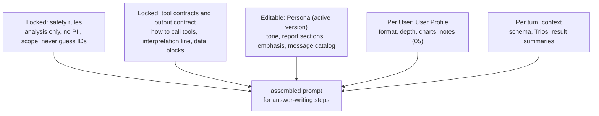
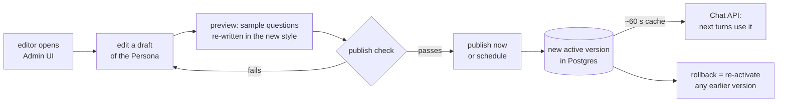

# 09 · Agility: Persona management (Req 8)

> **Requirement.** The CEO wants to change the tone of the reports weekly. Non-developers must be able to update the agent's instructions without a redeploy.

## Two kinds of instructions

Not everything that shapes the agent belongs to the same owner. The design separates them by who changes them and how often.

| | **Configuration** | **Persona** |
|---|---|---|
| **Holds** | Model IDs and tiers, provider, fallbacks, limits, budgets, timeouts | Tone, report structure, emphasis, wording of user-facing messages |
| **Changed by** | Developers | Non-developers (the CEO's office, an editor they name) |
| **Changes** | Rarely, with an engineering reason | Weekly or whenever leadership wants |
| **Stored in** | `.env` / deployment config | Versioned rows in Postgres |
| **Takes effect** | On restart (acceptable for engineering changes) | Within ~60 s, no restart, no redeploy |
| **Checked by** | The release gate ([07](07-quality-assurance.md)) | A publish check in the Admin UI (below) |

Putting tone in `.env` would make every weekly tone change a developer ticket. Putting model IDs in the Persona would let a non-developer change cost and safety behavior. Each owner gets the lever they need and no other.

## The prompt is layered, and only one layer is editable



- **Locked layers** (safety rules, tool contracts, the output contract) live in code and change only through a release. The Persona cannot override them, and the precedence in [05](05-learning-loop.md) puts them above everything else.
- **The Persona is injected as a delimited block of style guidance.** It shapes how answers are written, not what the agent may do. A Persona that said "include customer emails" would change nothing: the locked rules forbid it, the query guard cannot reach the columns, and the output PII filter removes them ([03](03-safety-and-pii.md)).
- **Only answer-writing steps read the Persona.** The input guard and router prompts are locked entirely, so a Persona edit can never weaken classification.

## What a Persona contains

A structured form, not a free-form system prompt, so editors cannot break the agent by accident and each field can be checked.

| Field | Example |
|---|---|
| `tone` | A preset (`direct`, `warm`, `formal`) plus up to a few sentences of free text: "Confident and brief. Lead with the decision, then the evidence." |
| `report_sections` | Required sections in order: Summary, Key insights, Risks, Action items for next quarter |
| `emphasis` | What to highlight: "Always relate results to margin, not just revenue." |
| `vocabulary` | Preferred and banned terms: "say *Customers*, never *users*"; "avoid jargon such as *cohort* without explaining it" |
| `examples` | One or two short example answers in the desired style |
| `messages` | The wording of the message catalog ([06](06-resilience.md)), so error messages share the Persona's tone. Each class must keep its next step. |

The Persona governs tone and required sections. The User Profile governs presentation (format, depth, charts). A User who prefers bullets gets the Persona's action items, as bullets ([05](05-learning-loop.md)).

## Editing without a redeploy



1. **Edit a draft** in the Admin UI, behind IAP and SSO. Only Users with the Persona-editor role can open it.
2. **Preview.** The draft is applied to a fixed set of sample questions, side by side with the current Persona. The preview re-writes answers from stored query results, so it costs a few model calls and no BigQuery scans.
3. **Publish check** (automated, a few seconds):
   - field limits (length, number of examples) and a scan of the free text with the input guard's injection rules;
   - every required report section appears in the sample reports;
   - a few red-team prompts from the safety suite still refuse correctly;
   - the judge confirms the figures in the sample answers did not change. A Persona changes style, never content.
4. **Publish or schedule.** Each publish creates a new immutable version; one pointer marks the active one. Scheduling ("activate Monday 09:00") lets the weekly tone change be prepared in advance.
5. **The agent picks it up.** The Chat API loads the active version with a ~60 s cache. A Conversation in progress switches at its next turn. No restart, no deploy.
6. **Rollback** is re-activating any earlier version, with the same ~60 s effect. All versions are kept.

Every publish and rollback records who, when and what changed. Every trace records the Persona version used ([08](08-observability.md)), so a quality change after a Persona change is visible and attributable: trusted-answer rate, CSAT and the online judge's presentation score per Persona version.

**Resilience.** If the Persona store cannot be read, the Chat API keeps the last cached version. On a cold start with no cache, it uses a bundled default Persona ([06](06-resilience.md)).

**Store.** Postgres is the default, because it is already there and it keeps Persona versions transactional with the rest of the app state ([ADR 0002](../adr/0002-postgres-for-app-state.md)). A prompt registry (Langfuse, LangSmith Prompt Hub) is a drop-in alternative behind the `PersonaStore` port if the trace backend chosen in production is Langfuse ([ADR 0006](../adr/0006-ports-and-adapters.md)).

## In the prototype

Persona management is design-only in the assignment. The prototype has a **stretch** slice:

- `persona.yaml`, with the same fields as above, re-read on **every turn**, so editing the file changes the next answer with no restart:

```yaml
version: 2026-11-16
tone:
  preset: direct
  notes: Confident and brief. Lead with the decision, then the evidence.
report_sections: [Summary, Key insights, Risks, Action items]
emphasis: Relate results to margin, not just revenue.
vocabulary:
  prefer: { users: Customers }
messages:
  data_source_down: "The sales data is unavailable right now. You can still open your saved reports."
```

- loaded behind the `PersonaStore` port, so the Postgres adapter and the Admin UI replace it without touching the agent.

Not in the prototype: the Admin UI, versions, preview, the publish check and scheduling.
