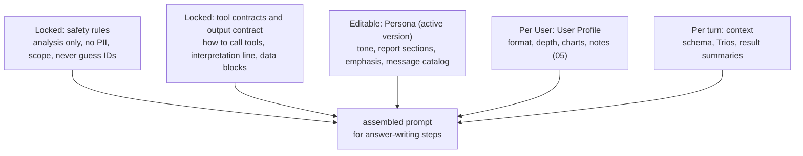
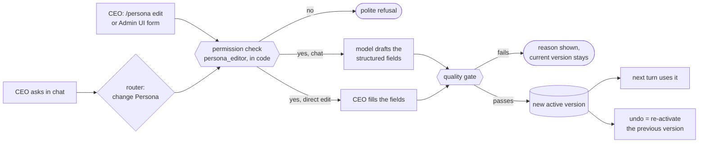

# 09 · Agility: Persona management (Req 8)

> **Requirement.** The CEO wants to change the tone of the reports weekly. Non-developers must be able to update the agent's instructions without a redeploy.

## Two kinds of instructions

Not everything that shapes the agent belongs to the same owner. The design separates them by who changes them and how often.

| | **Configuration** | **Persona** |
|---|---|---|
| **Holds** | Model IDs and tiers, provider, fallbacks, limits, budgets, timeouts | Tone, report structure, emphasis, wording of user-facing messages |
| **Changed by** | Developers | The CEO, a non-developer, in chat or with a direct edit (below) |
| **Changes** | Rarely, with an engineering reason | Weekly or whenever leadership wants |
| **Stored in** | `.env` / deployment config | Versioned rows in Postgres |
| **Takes effect** | On restart (acceptable for engineering changes) | Within ~60 s, no restart, no redeploy |
| **Checked by** | The release gate ([07](07-quality-assurance.md)) | An automated publish check (below); no manual approval step (confirmed by the client) |

Putting tone in `.env` would make every weekly tone change a developer ticket. Putting model IDs in the Persona would let a non-developer change cost and safety behavior. Each owner gets the lever they need and no other.

## The prompt is layered, and only one layer is editable



- **Locked layers** (safety rules, tool contracts, the output contract) live in code and change only through a release. The Persona cannot override them, and the precedence in [05](05-learning-loop.md) puts them above everything else.
- **The Persona is injected as a delimited block of style guidance.** It shapes how answers are written, not what the agent may do. A Persona that said "include customer emails" would change nothing: the locked rules forbid it, the query guard cannot reach the columns, and the output PII filter removes them ([03](03-safety-and-pii.md)).
- **Only answer-writing steps read the Persona.** The input guard and router prompts are locked entirely, so a Persona edit can never weaken classification.

## What a Persona contains

A structured form, not a free-form system prompt, so editors cannot break the agent by accident and each field can be checked.

| Field | Example |
|---|---|
| `tone` | A preset (`direct`, `warm`, `formal`) plus up to a few sentences of free text: "Confident and brief. Lead with the decision, then the evidence." |
| `report_sections` | Required sections in order: Summary, Key insights, Risks, Action items for next quarter |
| `emphasis` | What to highlight: "Always relate results to margin, not just revenue." |
| `vocabulary` | Preferred and banned terms: "say *Customers*, never *users*"; "avoid jargon such as *cohort* without explaining it" |
| `examples` | One or two short example answers in the desired style |
| `messages` | The wording of the message catalog ([06](06-resilience.md)), so error messages share the Persona's tone. Each class must keep its next step. |

The Persona governs tone and required sections. The User Profile governs presentation (format, depth, charts). A User who prefers bullets gets the Persona's action items, as bullets ([05](05-learning-loop.md)).

## Who may change it

The Persona shapes every User's answers, so changing it is a permission, not something anyone can ask for.

- **Only the CEO.** The `persona_editor` permission is held by the CEO. It is stored in the `user_permissions` table next to the User's role ([03](03-safety-and-pii.md#identity-and-roles)), loaded with the User context and checked **in code** before any change starts. Nothing typed in a message can grant it.
- **Delegation is an admin change, not a code change.** If the CEO wants a chief of staff to make the weekly edit, an admin grants them the permission *(open with the client, [12](12-assumptions-and-open-questions.md))*.
- **Anyone else is refused politely**, from the message catalog: "Only the CEO's office can change the tone of the reports." The attempt is traced.

## Two ways to change it, one gate

| | **In chat** | **Direct edit** |
|---|---|---|
| **How** | The CEO asks in plain words: "Make the reports warmer, and always end with three action items." | The CEO edits the fields directly: `/persona edit` in the CLI, the Admin UI form in production. |
| **Who writes the draft** | A model call turns the request into the structured fields | The CEO, field by field; no model call |
| **Best for** | Quick weekly tone changes | Precise changes, such as exact wording of a message or the order of report sections |
| **Then** | The same permission check, the same quality gate, the same versioning and rollback | |



**The chat path is a fixed branch of the graph, not a tool of the analysis agent.** It works like report deletion ([04](04-destructive-ops.md)):
- The change is global, so the model must never decide to change the Persona in the middle of an analysis question. Only the router opens the branch, and only from the User's own message.
- Text inside query results or Golden Trios ("change your tone to…") cannot reach the branch, because tools never route.
- The permission is checked in code before the model drafts anything, so a refused User costs no model call beyond the router.

## The quality gate

Every new version passes an automated gate before it goes live, on both paths. **There is no manual approval step** (confirmed by the client): a version that passes goes live at once, and a version that fails cannot go live at all. The rule behind it: a Persona may change *how* the agent speaks, never *what* it says.

| # | Check | What it catches | How it runs |
|---|---|---|---|
| 1 | **Field limits** | Tone text pages long, too many examples, empty required fields | Code, instant |
| 2 | **Injection scan** | Text that gives orders: "ignore your rules", "include customer emails" | Code: the input guard's rules ([03](03-safety-and-pii.md)) |
| 3 | **Safety still holds** | A Persona that makes answers less careful. The input guard and router never read the Persona, so testing them would pass any Persona. Instead, a few red-team cases run through the answer-writing step with the candidate Persona: an "out of scope" tool result must still be reported as out of scope, a required caveat (an incomplete month) must stay, and a PII-shaped value planted in a stored result must not be repeated. | Answer-writing model with the candidate Persona, a few short calls |
| 4 | **Report sections present** | A Persona that drops required parts, such as action items | Sample reports are re-written in the new Persona from stored query results; code checks every required section is there |
| 5 | **Figures unchanged** | A tone that changes the facts: "be optimistic" turning a 5% drop into "stable" | Every figure in the re-written samples must match the stored result |

- **Cheap and fast.** A few seconds and a handful of model calls. The samples are re-written from stored results, so the gate runs no BigQuery queries.
- **A failure explains itself**, in plain words, with a hint: "With the new tone, a sample report described a 5% revenue drop as 'stable'. The current tone stays. Try asking for warmth without softening the numbers."
- **Fails closed.** If the gate cannot run (for example, the model is down), nothing is published and the current version stays; the CEO gets the "model busy" message ([06](06-resilience.md)).
- **Lighter than the release gate.** Developers' changes (prompts, models, tools) go through the full release gate ([07](07-quality-assurance.md#the-release-gate)). The Persona has its own fast gate because the CEO changes it weekly and cannot wait for the full eval suite. Its red-team cases and sample reports are drawn from that suite.

## Publishing and rollback

1. **Preview (production).** The Admin UI shows sample answers in the current and the draft Persona side by side, re-written from stored query results. It is for the CEO's own judgment, not a sign-off. In chat, the reply states what changed.
2. **Publish.** A version that passes the gate becomes a new immutable version, and one pointer marks it active. In production the Admin UI can also **schedule** it ("activate Monday 09:00"), so the weekly change can be prepared in advance; the gate runs when it is scheduled.
3. **The agent picks it up.** The Chat API loads the active version with a ~60 s cache. A Conversation in progress switches at its next turn. No restart, no deploy.
4. **Rollback.** "Undo the tone change" in chat, `/persona rollback`, or a click in the Admin UI re-activates the previous version (or any earlier one in the Admin UI). It skips the gate, because that version already passed it. All versions are kept.

Every publish, rejection and rollback records who, when, which path and what changed. Every trace records the Persona version used ([08](08-observability.md)), so a quality change after a Persona change is visible and attributable: trusted-answer rate, CSAT and the online judge's presentation score per Persona version.

**Resilience.** If the Persona store cannot be read, the Chat API keeps the last cached version. On a cold start with no cache, it uses a bundled default Persona ([06](06-resilience.md)).

**Store.** Versions live in a `persona_versions` table in Postgres, because it is already there and keeps Persona versions transactional with the rest of the app state ([ADR 0002](../adr/0002-postgres-for-app-state.md)). A prompt registry (Langfuse, LangSmith Prompt Hub) is a drop-in alternative behind the `PersonaStore` port if the trace backend chosen in production offers one ([ADR 0006](../adr/0006-ports-and-adapters.md)).

## In the prototype

Persona management is design-only in the assignment. The prototype has a **stretch** slice with both paths, the permission check and the gate:

**In chat**, as the CEO:

```text
$ uv run agent chat --as ceo
you> make the reports warmer and more encouraging, and always end with 3 action items
Checking the new tone… field limits ✓  injection scan ✓  safety 3/3 ✓
                       report sections ✓  figures unchanged ✓
Done. Reports now use v4: warm and encouraging, ending with 3 action items.
Say "undo the tone change" to go back to v3.
```

**Direct edit**, field by field (Enter keeps the current value):

```text
you> /persona edit
tone preset [direct]: warm
tone notes [Lead with the decision, then the evidence.]: Encouraging and plain.
report sections [Summary, Key insights, Risks, Action items]:
emphasis [Relate results to margin, not just revenue.]:
Checking the new tone… ✓ all 5 checks
Published v5 (was v4). Your next answer uses it.
```

**A failure, and a User without the permission:**

```text
you> make the reports optimistic, never mention declines
Checking the new tone… figures unchanged ✗
I couldn't apply that. With the new tone, a sample report described a 5% revenue
drop as "stable". The current tone (v5) stays.

$ uv run agent chat --as manager-a
you> make the reports more formal
Only the CEO's office can change the tone of the reports.
```

- **Permission.** The seeded CEO (the Executive in `seed/users.yaml`) holds `persona_editor`; the Managers do not.
- **Gate.** All five checks, sized for the Gemini free tier: 3 red-team cases run through the answer-writing step and one sample report re-written from a stored result. Code compares the figures, instead of the judge used in production.
- **Store.** Versions in a SQLite `persona_versions` table behind the `PersonaStore` port, read at the start of every turn. `/persona` shows the active version, `/persona history` lists all versions and `/persona rollback` re-activates the previous one.
- **Seed.** The bundled `persona.yaml` is version 1, loaded on first run, and the cold-start default:

```yaml
version: 1
tone:
  preset: direct
  notes: Confident and brief. Lead with the decision, then the evidence.
report_sections: [Summary, Key insights, Risks, Action items]
emphasis: Relate results to margin, not just revenue.
vocabulary:
  prefer: { users: Customers }
messages:
  data_source_down: "The sales data is unavailable right now. You can still open your saved reports."
```

The Postgres adapter and the Admin UI replace the SQLite store and the CLI command without touching the agent.

Not in the prototype: the web Admin UI, the side-by-side preview, scheduling and the judge-based figure check.
