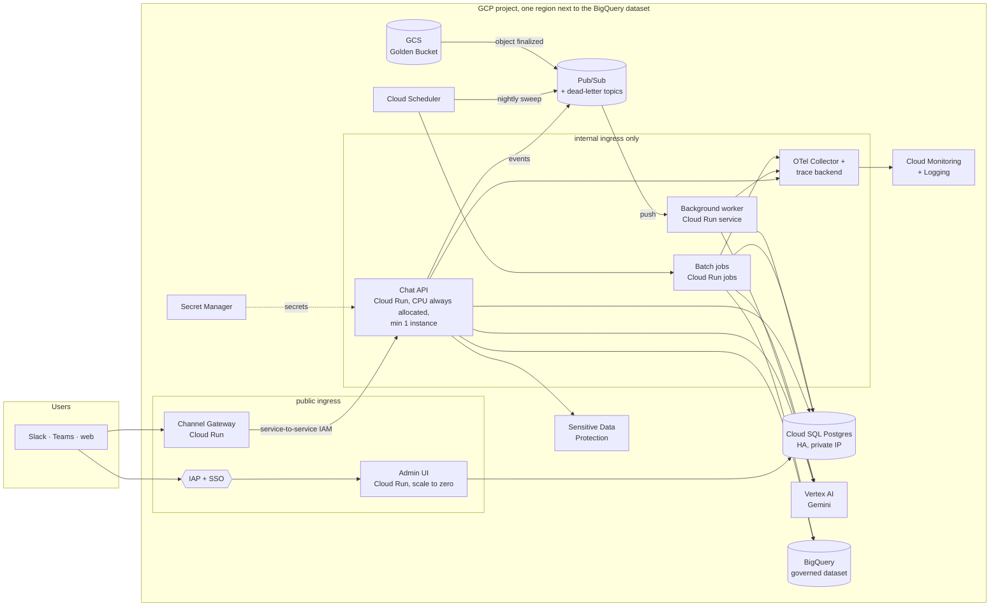

# 11 · Operations

This section covers how the system is deployed and run: the reference GCP deployment, how it scales, the SLOs it is held to, what it costs and how that cost is kept bounded, and how it is secured. The components are described in [01](01-architecture.md); the reasons for each service are in [10](10-stack-rationale.md).

## Deployment

| Piece | Runs as | Settings that matter |
|---|---|---|
| **Channel Gateway** | Cloud Run service, public ingress | Acknowledges each channel within its deadline; holds the per-turn deadline that sends "taking too long" ([06](06-resilience.md)) |
| **Chat API** | Cloud Run service, internal ingress only | CPU always allocated (turns continue after the ack); min 1 instance so the first question of the day has no cold start; a max-instances cap sized to the Postgres connection limit |
| **Admin UI** | Cloud Run service behind IAP | Scales to zero; used weekly by the CEO for the Persona and daily by analysts ([09](09-persona-management.md), [02](02-hybrid-intelligence.md)) |
| **Background worker** | Cloud Run service, internal ingress, same image as the services | Pub/Sub push subscriptions, because a Cloud Run job is not an HTTP endpoint and cannot receive a push ([Cloud Run jobs](https://cloud.google.com/run/docs/execute/jobs), [Pub/Sub tutorial](https://cloud.google.com/run/docs/tutorials/pubsub)). Returns success only after its work commits; the dead-letter topic sits on each subscription. Its own model budget, so it never competes with Users |
| **Batch jobs** | Cloud Run jobs, same image | Started by Cloud Scheduler; run off-peak with their own model budget. A failed run is retried and alerted |
| **Postgres** | Cloud SQL, HA (regional, standby in a second zone) | Automatic failover; point-in-time recovery; private IP only |
| **Trace backend** | Self-hosted Phoenix or Langfuse ([08](08-observability.md)) | Internal ingress; access limited to the AI-ops team |

- **One region.** Every service runs in the region of the governed BigQuery dataset, so no query result or prompt crosses regions. Vertex AI has a second region configured as a fallback only ([06](06-resilience.md)).
- **Environments.** Separate projects for dev, staging and production, created from the same infrastructure-as-code definitions. Staging points at a copy of the governed dataset and runs the canaries and the release gate ([07](07-quality-assurance.md)).
- **Delivery.** CI builds one container image per commit, runs the deterministic tests and pushes the image to Artifact Registry. A release deploys a new Cloud Run revision with no traffic; the canary percentage and full rollout are traffic splits between revisions, and rollback is moving traffic back. Prompt, model and Persona changes do not need a deploy at all: they are configuration or Persona versions ([09](09-persona-management.md)).
- **Restarts keep saved state, not work in progress.** Graph state is checkpointed after every node ([01](01-architecture.md#conversation-state)), so Conversation history and a paused Deletion Plan survive any instance. A turn that was running when its instance stopped is **not resumed**: Cloud Run may stop an instance at any time with a short grace period, even with min instances and CPU always allocated ([Cloud Run billing settings](https://cloud.google.com/run/docs/configuring/billing-settings)). Each turn has a status (`running`, `done`, `failed`) and a deadline in Postgres. When the stream ends without a reply, or the deadline passes, the Gateway sends the failure message with the reference ID and the User asks again ([06](06-resilience.md#never-crashing-the-ui)). Every BigQuery job carries a job timeout, so a query left behind stops by itself. Guaranteed resume would need a queue and workers, the growth path in [Scale](#scale).
- **Portable.** Every box is a container or a managed service behind a port. The same images run on any container host; the equivalents are listed in [10](10-stack-rationale.md).

## Scale

**Sizing (from the client):** ~1,000 questions a day, ~100 Saved Reports a day, only a few Users active at once, ~1M new rows a day in the data ([12](12-assumptions-and-open-questions.md)).

**What that means at peak.** 1,000 questions over a ~10-hour business day is ~100 an hour. At three times that rate in the busiest hour, about 5 questions arrive per minute, and at ~20 s each, about **2 turns run at once**. At ~5–10 model calls per question, that is a few dozen model calls a minute. One Chat API instance handles this; the turn is I/O-bound (waiting on Gemini and BigQuery), not CPU-bound.

This is a low-scale internal tool, so the design adds no high-scale machinery. Each limit has a named growth path instead:

| What limits us first | Today | Growth path |
|---|---|---|
| Gemini quota | Per-process token-bucket rate limiter; background jobs off-peak | A shared limiter (Memorystore token bucket); provisioned throughput |
| Concurrent turns | Turns run asynchronously inside the Chat API; Cloud Run adds instances | A task queue (Cloud Tasks or Pub/Sub) between Gateway and workers for backpressure ([01](01-architecture.md#how-components-communicate)) |
| BigQuery cost | Bytes cap, dry run, result cache, per-User quotas; relies on date partitioning by the data team | Reserved slots (capacity pricing) when on-demand spend passes the break-even |
| Postgres connections | Cloud SQL connector pooling; max-instances cap | PgBouncer; a read replica for report and Trio search |
| Data growth (~1M rows a day) | Date-bounded queries on partitioned tables stay flat in cost | Clustering by product or Brand; pre-aggregated tables from the data team |
| Retrieval quality as Trios grow | Fused vector + keyword search, a similarity threshold, top 3 ([02](02-hybrid-intelligence.md#query-time-giving-the-agent-the-right-knowledge)) | A reranker over the top ~20 when recall@3 or retrieval health falls: one call, ~100–300 ms per analysis turn |
| A second consumer of governed data | Tools in-process ([ADR 0007](../adr/0007-in-process-tools-mcp-as-growth-option.md)) | A governed-data MCP server enforcing guard, scope and PII itself |

## SLOs

The client gave response-time expectations; the targets are ours to define.

| SLO | Target | Measured as | Why |
|---|---|---|---|
| Question latency | p95 ≤ 30 s | Gateway receive → final reply, analysis turns | The client expects 10–30 s. Progress messages stream meanwhile. |
| Report latency | p95 ≤ 120 s | Same, for turns that produce a report | The client expects 1–2 min. |
| Availability | 99.5% in business hours | Share of turns that end in an answer rather than an infrastructure-failure message, plus canary success | An internal tool: about 1–1.5 hours of degraded service a month during business hours is acceptable; no 24/7 on-call |
| Trusted-answer rate | ≥ 85%, re-baselined after the pilot | No error, no rephrase, no negative feedback ([08](08-observability.md)) | The starting point from the offline eval, tightened as data accumulates |
| PII in output | 0 | Output-filter hits | A hard requirement, not a budget. Any hit pages at once. |
| Answers outside the User's scope | 0 | The scope auditor over executed BigQuery jobs, and red-team canaries ([03](03-safety-and-pii.md#how-we-know-it-works)) | A hard requirement |

- **Error-budget policy.** While the latency or availability budget is exhausted, reliability work comes before new features.
- **Not counted against availability:** answers that are correct refusals (out of scope, PII request, quota reached). They are the system working.
- Alerts on these SLOs (burn-rate paging in business hours, immediate paging for PII or scope) are defined in [08](08-observability.md#knowing-when-slos-alerts-and-probes).

## Cost estimate (back of the envelope)

The estimate below is for **1,000 questions a day** before launch. Its inputs are assumptions; once the prototype and the pilot produce traces, tokens and bytes per question are **measured** ([08](08-observability.md)) and the estimate is recomputed from them. Prices are list prices from public pricing pages in November 2026 and change often; they are inputs, not part of the design.

**Inputs (assumed):**

| Input | Value |
|---|---|
| Flash-Lite price, per 1M tokens in / out | $0.25 / $1.50 |
| Flash price | $1.50 / $9.00 |
| Pro price | $2.00 / $12.00 |
| BigQuery on-demand | $6.25 per TiB scanned |
| Router + guard per question | 1 call, ~3k tokens in, ~0.2k out (Flash-Lite) |
| Analysis per question | ~5 calls, ~8k tokens in and ~0.5k out each (Flash); Trio retrieval is a fixed step, not a model call ([ADR 0008](../adr/0008-trio-retrieval-is-a-fixed-step.md)) |
| Reports | ~100 a day, 1 extra call of ~15k in, ~2k out (Pro) |
| BigQuery per question | ~2.5 executions × ~2 GB billed (date-bounded, few columns); dry runs are free |

**Daily cost:**

| Item | Calculation | ≈ $/day |
|---|---|---:|
| Router + guard | 1,000 × (3k × $0.25 + 0.2k × $1.50) / 1M | 1 |
| Analysis | 1,000 × (40k × $1.50 + 2.5k × $9.00) / 1M | 83 |
| Reports | 100 × (15k × $2.00 + 2k × $12.00) / 1M | 5 |
| Online judge (5% of turns), entity extraction, embeddings | small calls | 3 |
| Synthetic canaries | ~220 runs a day, every day (below) × ~$0.05 (short questions with known answers) | 11 |
| BigQuery | 1,000 × 5 GB ≈ 4.9 TiB × $6.25 | 31 |
| **Variable total, per business day** | | **≈ 134** |

**Fixed infrastructure, per month:** Chat API and Gateway with one warm instance each (~$150), Cloud SQL HA (~$300), the self-hosted trace backend (~$100), Monitoring and Logging (~$50), and Pub/Sub, Scheduler, GCS, Secret Manager and Sensitive Data Protection (under $50 together at this volume). About **$650 a month**.

**Result:** 22 business days × $123 (Users) + 30 days × $11 (canaries) + $650 (fixed) ≈ **$3,700 a month**, or about **$0.17 per question** all in. The analysis model is about half of it, so the two numbers that matter most are the Flash price and the number of analysis steps per question. Doubling either adds about $1,800 a month; no other input moves the total by more than a few hundred dollars.

## Cost controls

Every control below is a ceiling, so a bug or a heavy User cannot turn into an open-ended bill. Starting values are configuration, tuned from traces.

| Control | Ceiling (starting value) | Where |
|---|---|---|
| Bytes per query | `maximum_bytes_billed` (e.g. 20 GB, ~$0.12); over-cap queries are rejected at the free dry run, or at execution when queries run as the User under row-level security, where a dry run reports 0 bytes ([ADR 0011](../adr/0011-query-guard-parses-with-sqlglot.md)) | `run_sql` ([06](06-resilience.md)) |
| Model calls per turn | Analysis-step cap, 2 SQL retries, 1 empty-result probe (code, not a model call), a turn deadline | Graph state ([06](06-resilience.md)) |
| Prompt size | Last N turns verbatim plus a running summary; result summaries, never rows | Conversation state ([01](01-architecture.md#conversation-state)) |
| Per-User daily quota | Tokens and BigQuery bytes, about 5× a typical User's day; "daily quota reached" message, resets at midnight | Chat API |
| Global daily spend cap | About 3× the expected daily spend. At 80%: an alert, and background jobs pause so only interactive turns spend. At 100%: new turns get the "daily quota reached" message until midnight | Chat API, from its own token and bytes counters; billing data arrives late, so the billing alert is only a backstop ([08](08-observability.md)) |
| Repeated questions | Result cache keyed on the final SQL, its bound parameters and the User's scope version, valid until the next data load, plus BigQuery's own cache | `QueryRunner` adapter |
| Model tier per step | Flash-Lite for classification and extraction; Pro only for reports and the judge | `.env` ([10](10-stack-rationale.md)) |
| Background jobs | Off-peak, with their own budget; batch API pricing where the provider offers it | Worker service and Cloud Run jobs |
| Canaries | 4 short questions every 15 minutes in business hours, hourly outside them (~220 runs a day instead of ~380) | Cloud Scheduler |

The cost metric that matters is **cost per successful answer** ([08](08-observability.md)): a change that saves tokens by failing more often shows up as a cost increase, not a saving.

## Security

The data-access layers (input guard, query guard, row and column security, least privilege, output PII filter) are in [03](03-safety-and-pii.md). This part covers the platform around them.

| Area | Control |
|---|---|
| **User identity** | SSO through the Channel Gateway; IAP in front of the web channel and the Admin UI. Queries run as the read-only service account by default, or with the User's short-lived credentials once they have consented and the channel can carry the token ([03](03-safety-and-pii.md#data-platform-production)). |
| **Roles and permissions** | Roles: Executive, Manager (with Brand Assignments), analyst (Trio review queue), AI-ops (raw traces and interaction store). Permissions: `persona_editor`, held by the CEO ([09](09-persona-management.md#who-may-change-it)). Default deny for anyone else. Roles and permissions live in Postgres and are administered, never set by a message. |
| **Service identity** | One service account per service, each with only the roles it needs. Only the Chat API's query identity can read BigQuery, and only the governed dataset. The Gateway can only invoke the Chat API. |
| **Network** | Only the Gateway and the IAP-protected Admin UI accept traffic from outside; the Chat API, jobs and trace backend use internal ingress. Cloud SQL has a private IP only. A VPC Service Controls perimeter around BigQuery, GCS and Vertex AI blocks data exfiltration from inside the project. |
| **Secrets** | Secret Manager only; no secrets in images, `.env` files or traces in production. |
| **Data at rest and in transit** | Google-managed encryption by default (customer-managed keys available if required); TLS everywhere. |
| **Model provider** | Gemini through Vertex AI, in our project and region, under terms that exclude training on customer data. Prompts carry business data but no PII. |
| **Audit** | Deletion audit rows, Persona publish and rollback history, logged reads of raw traces, and Cloud Audit Logs for every admin action on the platform. Every BigQuery job the agent runs carries the labels `agent_user` and `agent_turn` (User and turn ID), so `INFORMATION_SCHEMA.JOBS` ties each executed query to who asked; the scope auditor reads them ([03](03-safety-and-pii.md#how-we-know-it-works)). |
| **Supply chain** | Locked dependencies (`uv.lock`); images scanned in Artifact Registry; deploys only from CI. |
| **Dead-letter queues** | The Pub/Sub service agent holds `roles/pubsub.publisher` on each dead-letter topic and `roles/pubsub.subscriber` on each source subscription; without them nothing is forwarded ([dead-letter topics](https://docs.cloud.google.com/pubsub/docs/dead-letter-topics)). Each dead-letter topic has a pull subscription set never to expire, because a topic with no subscription loses what is published to it. Messages carry IDs only, so the DLQ holds no PII. |
| **Recovery** | Postgres: point-in-time recovery (RPO of minutes), HA failover in about a minute, restore drills each quarter. BigQuery data is the data team's to back up. Persona versions and Trio versions are never overwritten, so a bad edit is a rollback, not a restore. |

## Running it

- **Ownership.** The AI-ops team owns the agent in production: on-call in business hours, paged at any hour only for a PII hit or an out-of-scope answer ([08](08-observability.md)). *(Assumption, [12](12-assumptions-and-open-questions.md).)*
- **Regular work:** the weekly review of findings and unclassified errors ([05](05-learning-loop.md)); dead-letter queues inspected and, after a fix, replayed by re-publishing to the source topic (handlers are idempotent, so a double replay is safe); the monthly domain-expert session; quarterly restore drills and quota reviews.
- **Retention.** Raw traces, interaction records and Conversation checkpoints are kept 90 days; dead-lettered events 7 days (the Pub/Sub default, [subscription properties](https://docs.cloud.google.com/pubsub/docs/subscription-properties)); anonymized aggregates and deletion audit rows indefinitely; Saved Reports and User Profiles until their User deletes them ([01](01-architecture.md#where-data-lives-and-how-it-is-handled)). *(Assumptions, [12](12-assumptions-and-open-questions.md).)*

## In the prototype

Operations are design-only. The prototype runs on a laptop or in a container:

- `uv sync && uv run agent chat --as <id>` (or `agent web`), or the Docker image, with Google credentials from a mounted ADC file; Phoenix runs next to it on the host;
- SQLite for all app state, Gemini on the Google AI Studio free tier with a client-side rate limiter sized to its limits, `bigquery-public-data.thelook_ecommerce` read with the developer's own credentials;
- of the cost controls, only the per-query bytes cap and the per-turn ceilings (retries, steps, deadline);
- per-turn latency and outcome in the JSONL traces, which are the data behind the SLOs and the cost estimate above.

Not in the prototype: any cloud deployment, SLO monitoring, quotas, the spend cap, caching, the reranker, BigQuery job labels and the scope auditor, and the security controls above beyond read-only credentials.
