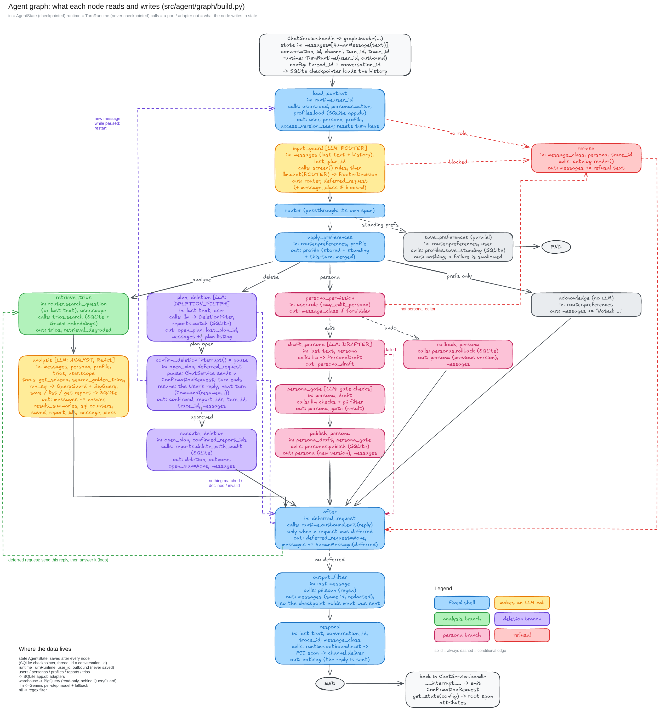
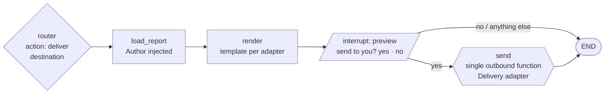

# 03 · Graph state

The LangGraph state is [`AgentState`](../../src/agent/graph/state.py): one per Conversation (`thread_id = conversation_id`), checkpointed after every node. The node names are in [`graph/build.py`](../../src/agent/graph/build.py) and are also the span names in traces. Edges follow the reference graph in [HLD 01 § Agent graph](../hld/01-architecture.md#agent-graph).

## The graph as built

Source: [diagrams/agent-graph.excalidraw](diagrams/agent-graph.excalidraw). Drawn from `build_graph`: solid edges are `add_edge`, dashed ones are `add_conditional_edges` (`_refused_or`, `_with_saving`, `_by_action`, `_planned`, `_deferred`, `permission_to`, `drafted_to`) and the `Command(goto=...)` of `confirm_deletion`. In each box, `in` is read from `AgentState` or `TurnRuntime`, `calls` is a port (the adapter behind it is in the bottom-left key), and `out` is what the node writes to state. Update it with the code, like the rest of this folder.

## Fields by lifetime

**Conversation fields** survive from turn to turn.

| Field | Type | Written by | Read by |
|---|---|---|---|
| `conversation_id`, `channel` | `UUID`, `Channel` | first turn | everything; `this_conversation` filters |
| `messages` | `list[AnyMessage]` with `add_messages` | every node that talks | analysis, answer writing |
| `running_summary` | `str` | `respond` when history exceeds `verbatim_turns` (`MODEL_SUMMARIZER`) | analysis |
| `access_version_seen` | `int` | `load_context` | `load_context`: if it differs from `user.access_version`, earlier results and the summary are dropped and the User is told |
| `open_plan` | `DeletionPlan \| None` | `plan_deletion` (replaces, so a new plan cancels the old one) | `confirm_deletion`, `execute_deletion`, `ChatService` (only the plan's User may resume) |
| `last_plan_id` | `UUID \| None` | `plan_deletion` | `input_guard`: with no plan open, a reply shaped like `yes` / `no` / `yes except 2` is answered `PLAN_EXPIRED`, never guessed at |
| `deferred_request` | `str \| None` | `router` | `after`: sends the branch's reply, then adds the request as a `HumanMessage` and routes to `retrieve_trios`, once the delete or Persona change is answered. Cleared when the plan is cancelled by another message |

**Turn fields** are reset by `load_context` at the start of every turn ([`TURN_KEYS`](../../src/agent/graph/state.py)).

| Group | Fields | Notes |
|---|---|---|
| Identity and trace | `turn_id`, `trace_id`, `user` | `user` is a frozen `UserContext`; nothing downstream can change it. `None` for an unknown or inactive User, whose turn goes straight to `refuse` with `NO_ROLE` (as does a known User with no role) |
| Presentation | `persona`, `profile` | `profile` is the stored profile with this turn's preferences merged in |
| Routing | `router` | the `RouterDecision` |
| Analysis | `trios`, `retrieval_degraded`, `analysis_steps`, `sql_attempts`, `sql_retries`, `empty_diagnoses`, `ran_sql`, `last_query_scope`, `result_summaries`, `saved_report_ids` | the retry counters are the `SqlBudget` that `run_sql` reads and returns; `ran_sql` with `trios == []` marks a retrieval gap |
| Deletion | `confirmed_report_ids`, `deletion_outcome` | `confirm_deletion` writes the IDs the reply confirmed; `execute_deletion` reads them |
| Persona | `persona_draft`, `persona_gate` | `draft_persona` writes the draft (the `PERSONA_DRAFTER` model's structured `Persona`, with `changed_fields` worked out in code); `persona_gate` writes the `PersonaQualityGate` result; `publish_persona` publishes or records the rejection. `/persona edit` runs the same gate and the same `publish_persona` function. A published or rolled-back version replaces `persona` for the rest of the turn, so a deferred request is answered in the new tone |
| Outcome | `error_class`, `message_class` | set by the graph-boundary catch-all or a refusal |

The HLD's scope list asks for "this turn's preference statements": they are `router.preferences`, and their effect is `profile`. Nothing stores them twice.

## What travels beside state

- **`TurnRuntime`** ([`state.py`](../../src/agent/graph/state.py)) is LangGraph's run `context`: the `user_id` the channel resolved and the turn's `Outbound`. `ChatService.handle` passes it to `invoke`; nodes read it from `Runtime`. It is never checkpointed.
- **The catch-all** is `ChatService.handle`, around `invoke`: an exception from any node ends the turn as its catalog message (`AgentError`) or `UNCLASSIFIED` with the reference ID. Nodes do not wrap themselves.
- **The checkpointer allowlist.** `CHECKPOINT_TYPES` lists every one of our types reachable from `AgentState`, derived from its annotations. The serializer is built with it, and tests run with `LANGGRAPH_STRICT_MSGPACK=true`, so a new state type that the checkpointer would refuse fails a test.

## What never enters state

- **Result rows.** `run_sql` returns rows to the model for one step only. State and the checkpoint keep a `ResultSummary` (columns, row count, key figures), so prompts stay small and checkpoints hold no bulk data ([01](../hld/01-architecture.md#conversation-state)). The `analysis` node keeps the ReAct loop's tool calls and results in its own message list and returns only the final answer and `ResultSummary.of(result)` (key figures for a one-row result, the shape otherwise).
- **Unfiltered outbound text.** The `output_filter` node writes the filtered reply into `messages`, so checkpoints hold what the User saw.
- **Ports and settings.** They reach tools through `TurnContext`, never through state, so they are not serialized.

## Pause and resume

`confirm_deletion` calls `interrupt()` with the `ConfirmationRequest`'s fields as plain JSON (so the checkpoint holds no new type); `ChatService` adds the trace ID and time and sends it through `Outbound`. The paused state, `open_plan` included, is checkpointed. `ChatService` sees the pause (`get_state(...).interrupts`) and resumes with `Command(resume={"text" | "response", "turn_id", "trace_id"})`: the new turn's IDs ride in the resume value, and `confirm_deletion` writes them to state. A message from anyone but the plan's User gets `PLAN_EXPIRED` and does not resume. `parse_reply` ([`core/confirmation.py`](../../src/agent/core/confirmation.py)) reads the reply:

| Decision | Next node |
|---|---|
| `ConfirmAll`, `ConfirmExcept` | `execute_deletion` with the confirmed IDs |
| `Decline` | `after` |
| `NeedsCount` | a second `interrupt()` in the same node, asking for the count; a second bare `yes` is `NotAnAnswer` |
| `NotAnAnswer` | the plan is cancelled (`open_plan = None`). A reply shaped like an answer that does not fit the plan (`yes except 4` to a plan of 3, a second bare `yes` to a large plan) ends with `PLAN_ANSWER_INVALID`; a button for another request with `PLAN_EXPIRED`; any other message re-enters as a new message at `load_context`, so it passes `input_guard` with fresh turn keys and a freshly loaded User |

Everything a node does before `interrupt()` must be safe to run twice, because LangGraph re-runs the node from its start on resume. `plan_deletion` is a separate node for that reason: the plan is built once, and `confirm_deletion` only reads it.

## The deliver branch (designed, not built)

The mechanics behind [ADR 0009](../adr/0009-outbound-actions-are-a-deliver-branch.md). Nothing here is wired yet.

**Entering the branch.** `deliver` becomes a fifth router action. The router returns it with a `destination` enum, either as the action ("email me last week's report") or as a `follow_up_action` after `analysis` ("create the Q1 report and email it"). The follow-up is a conditional edge after `analysis` that reads the router's decision from state; analysis itself does not choose it.

**Finding the report.** Code resolves which Saved Report to send, never the model:

| The User says | The report comes from |
|---|---|
| "create the Q1 report and email it" | `saved_report_ids[-1]` from this turn's `save_report` |
| "send it to Slack too" | `last_delivery.report_id` |
| "email me last week's report" | a report filter (the `DeletionFilter` shape, shared with the deletion branch) run against the Author's reports |

No match, or more than one, and the branch asks the User which report; an unsaved answer gets "save it first?" rather than a silent save.

- **Destination.** The router returns a `destination` with the action, from the User's words ("email it" → `email`). It is an enum (`email`, `slack`, `push`) checked in code. If none is named, the User Profile's default is used, then the current channel. A registry maps the enum to an adapter.
- **No model in the branch.** Each adapter renders the Saved Report with a template: email gets the full answer and tables, Slack gets the title, summary, main table and a link, and push gets only the title and a link. The short **summary** is written by the analysis sub-agent when it calls `save_report`, in the same turn as the figures it describes, so `save_report`'s PII filter covers it. Nothing new is written after the save.
- **PII is checked twice, both times by existing code.** Once at save time, and again at the single exit, which filters the preview and the sent message.
- **The interrupt, then the send.** `load_report` and `render` have no side effects, so they can run again safely when the graph resumes. `send` runs only after "yes", and it uses an idempotency key (report ID, report version, destination), so a retry after a crash never sends twice ([LangGraph: interrupts](https://docs.langchain.com/oss/python/langgraph/interrupts#side-effects-called-before-interrupt-must-be-idempotent), [fault tolerance](https://docs.langchain.com/oss/python/langgraph/fault-tolerance#protect-side-effects-with-an-idempotency-key)).
- **The next round.** The User's reply resumes the paused graph. "No" cancels, and any other message cancels and enters at the input guard, the same rules as a Deletion Plan ([04](../hld/04-destructive-ops.md#the-confirmation-flow)). After a send, the branch replies "Sent to …" and ends. It records `last_delivery` (report, destination, outcome) in graph state, so a later "send it to Slack too" can resolve "it". The next message starts a normal turn.
