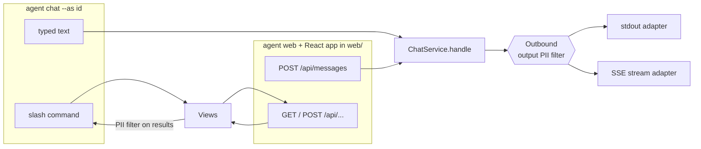

# 07 · Channels: one core, CLI and web UI

Everything the assistant does is reachable from the CLI **and** from the optional web UI ([ADR 0010](../adr/0010-ui-is-a-plain-folder-with-generated-types.md)). Neither channel holds logic of its own. Each one only translates its input into calls to two shared modules and renders what comes back:

| Shared module | Covers | Code |
|---|---|---|
| **`ChatService.handle(message, channel)`** | Everything that needs the agent: questions, reports, deletes and their confirmation, Persona changes in chat, preferences | [`core/chat.py`](../../src/agent/core/chat.py) |
| **`Views`** | Everything that does not: listing and opening reports, the User Profile, Persona view, history, direct edit and rollback, traces and stats | [`core/views.py`](../../src/agent/core/views.py) |



A test in Phase 4 pins this: for each row below, the CLI command and the web endpoint must call the same method.

## Feature map

| Feature | CLI | Web | Shared call |
|---|---|---|---|
| Ask, create a report, delete, change Persona in chat | type the message | `POST /api/messages` (`WebText`) → SSE | `ChatService.handle` |
| Answer a Deletion Plan | `yes` / `no` / `yes except 2,3` | checkboxes → `POST /api/messages` (`WebConfirmation`) | `ChatService.handle` → `parse_reply` |
| My reports | `/reports` | `GET /api/reports` | `Views.reports` |
| Open a report | (ask in chat) | `GET /api/reports/{id}` | `Views.report` |
| My preferences | `/profile` | `GET /api/profile` | `Views.profile` |
| Remove a preference / reset | `/profile clear [n]` | `DELETE /api/profile[/notes/{id}]` | `Views.remove_preference` |
| Active Persona | `/persona` | `GET /api/persona` | `Views.persona` |
| Persona history | `/persona history` | `GET /api/persona/versions` | `Views.persona_history` |
| Edit the Persona directly | `/persona edit` | `PUT /api/persona` (form) | `Views.edit_persona` → Quality Gate |
| Roll back the Persona | `/persona rollback` | `POST /api/persona/rollback` | `Views.rollback_persona` |
| Step tree of a turn | `/trace [id]` | `GET /api/traces/{id}` | `Views.trace` |
| Agent metrics | `/stats`, `agent stats` | `GET /api/stats` | `Views.stats` |
| Who am I (prototype) | `--as <id>` | `GET /api/dev/users` + picker | `UserDirectory` |

Report and Persona results reuse the tool output types ([05](05-tools.md)); trace and stats use [`contracts/views.py`](../../src/agent/contracts/views.py).

## The chat stream

- **Request:** `POST /api/messages`, body `WebRequest` = `WebText(conversation_id?, text)` or `WebConfirmation(conversation_id, request_id, approved, selected_indices?)` ([`contracts/web.py`](../../src/agent/contracts/web.py)). There is no `user_id` in the body.
- **Response:** `text/event-stream`. One event per `OutboundMessage`, with `event:` set to its `kind` (`progress`, `confirmation`, `reply`) and `data:` its JSON. The stream closes after a `reply` or a `confirmation`.
- **How it runs:** the handler builds an `InboundMessage`, creates an SSE `ChannelAdapter` that writes to a queue, and runs `ChatService.handle` in a worker thread. `Outbound` filters each message before the adapter sees it, so the browser gets exactly what the CLI would print.
- **Disconnects:** if the browser closes the stream, `deliver` drops messages and traces it. The turn finishes and is checkpointed, and the reply is in the Conversation history next time.

## Identity

- **Prototype:** `GET /api/dev/users` lists the seeded Users (`DevUser`), and the UI sends the choice in an `X-Agent-User` header. The equivalent of `--as`, enabled only when `WEB_DEV_IDENTITY=true` and bound to `127.0.0.1`.
- **Production:** IAP or the Channel Gateway's SSO sets the identity; the dev header is never accepted ([03](../hld/03-safety-and-pii.md#identity-and-roles)).
- Either way, the adapter resolves `user_id` before calling `ChatService` or `Views`, and those two load role, permissions and Brands themselves. Nothing in a request body can change them.

## Types for the UI

- FastAPI generates the OpenAPI document from the same Pydantic models. The SSE route declares `OutboundMessage` as its `text/event-stream` schema, so the event types are generated too.
- `make types` runs `openapi-typescript` into `web/src/api/schema.d.ts`; a check fails when the committed file is stale. No TypeScript type is written by hand.
- In development, Vite proxies `/api` to `agent web`, so there is no CORS setup.

## Layout

```
pyproject.toml           # unchanged; web deps are the optional extra `agent[web]`
src/agent/adapters/web/  # FastAPI app, SSE ChannelAdapter, dev identity
web/                     # React + Vite + pnpm
  src/api/schema.d.ts    # generated
Makefile                 # make dev (API + Vite), make types, make test
```
