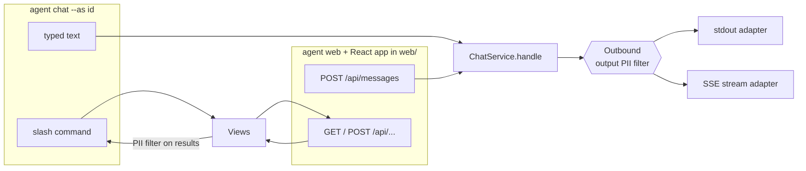

# 07 · Channels: one core, CLI and web UI

Everything the assistant does is reachable from the CLI **and** from the optional web UI ([ADR 0010](../adr/0010-ui-is-a-plain-folder-with-generated-types.md)). Neither channel holds logic of its own. Each one only translates its input into calls to two shared modules and renders what comes back:

| Shared module | Covers | Code |
|---|---|---|
| **`ChatService.handle(message, channel)`** | Everything that needs the agent: questions, reports, deletes and their confirmation, Persona changes in chat, preferences | [`core/chat.py`](../../src/agent/core/chat.py) |
| **`Views`** | Everything that does not: listing and opening reports, the User Profile, Persona view, history, direct edit and rollback, traces and stats | [`core/views.py`](../../src/agent/core/views.py) |



A test in Phase 4 pins this: for each row below, the CLI command and the web endpoint must call the same method.

The browser chat takes the same slash commands as `agent chat` (`/reports`, `/profile [clear [n]]`, `/persona [history|rollback]`, `/trace [id]`, `/stats [7d]`), plus `/new` and `/help`, in [`web/src/commands.ts`](../../web/src/commands.ts). Each one calls the route of its row below as the picked User, never the agent, and renders the result as the CLI does. `/persona edit` takes the changed fields inline (`/persona edit tone.preset=formal`) instead of asking field by field. Any other text, as on the CLI, goes to `ChatService`.

## Feature map

| Feature | CLI | Web | Shared call |
|---|---|---|---|
| Ask, create a report, delete, change Persona in chat | type the message | `POST /api/messages` (`WebText`) → SSE | `ChatService.handle` |
| Answer a Deletion Plan | `yes` / `no` / `yes except 2,3` | checkboxes → `POST /api/messages` (`WebConfirmation`) | `ChatService.handle` → `parse_reply` |
| My reports | `/reports` | `GET /api/reports` | `Views.reports` |
| Open a report | (ask in chat) | `GET /api/reports/{id}` | `Views.report` |
| My preferences | `/profile` | `GET /api/profile` | `Views.profile` |
| Remove a preference / reset | `/profile clear [n]` | `DELETE /api/profile[/notes/{id}]` | `Views.remove_preference` |
| Active Persona | `/persona` | `GET /api/persona` | `Views.persona` |
| Persona history | `/persona history` | `GET /api/persona/versions` | `Views.persona_history` |
| Edit the Persona directly | `/persona edit` | `PUT /api/persona` (the changed fields) | `Views.edit_persona(user_id, changes)` → Quality Gate. `changes` maps a field (`emphasis`, `tone.preset`, `messages.model_busy`, …) to its new value, applied to the stored version, never to the PII-filtered one `/persona` shows |
| Roll back the Persona | `/persona rollback` | `POST /api/persona/rollback` | `Views.rollback_persona` |
| Step tree of a turn | `/trace [id]` | `GET /api/traces[/{id}]` (none: the User's last turn) | `Views.trace` |
| Agent metrics | `/stats [7d]`, `agent stats --as <id>` | `GET /api/stats` | `Views.stats` |
| Who am I (prototype) | `--as <id>` | `GET /api/dev/users` + picker | `UserDirectory` |

`Views(ports, limits)` builds the same `TurnContext` a tool gets for the User the channel resolved; an unknown User or one with no role raises `PermanentError(NO_ROLE)`. `build_app` in [composition.py](../../src/agent/composition.py) returns `ChatService` and `Views` over one set of ports. Report and Persona results reuse the tool output types ([05](05-tools.md)); trace and stats use [`contracts/views.py`](../../src/agent/contracts/views.py), built from `Tracer.read` by [`core/observability.py`](../../src/agent/core/observability.py). `Views.trace` returns `None` for a missing turn and for another User's alike; `Views.stats` is for Executives (`PermanentError(STATS_FORBIDDEN)` otherwise) and prices tokens with `MODEL_PRICES`. Its families are `quality`, `safety`, `cost`, `reliability`, `knowledge`, `deletion`, plus `by_node` (`<node>.calls`, `.p50_s`, `.p95_s`, for node spans directly under the turn) and `by_intent` (`<action>.turns`, `.task_success_rate`); rates end in `_rate` and are `"n/a"` with nothing to count.

## The chat stream

- **Request:** `POST /api/messages`, body `WebRequest` = `WebText(conversation_id?, text)` or `WebConfirmation(conversation_id, request_id, approved, selected_indices?)` ([`contracts/web.py`](../../src/agent/contracts/web.py)), told apart by `kind` (`text`, `confirmation`), which the body must carry. There is no `user_id` in the body, and both models forbid unknown fields, so a body that names a User is refused with 422.
- **Response:** `text/event-stream`. One event per `OutboundMessage`, with `event:` set to its `kind` (`progress`, `confirmation`, `reply`) and `data:` its JSON. The stream closes after a `reply` or a `confirmation`.
- **How it runs:** the handler builds an `InboundMessage` (channel `web`) or a `ConfirmationResponse`, creates an `SseChannel` ([`adapters/web/sse.py`](../../src/agent/adapters/web/sse.py)) that writes to a queue, and runs `ChatService.handle` in a worker thread (not a daemon). `Outbound` filters each message before the adapter sees it, so the browser gets exactly what the CLI would print. When `handle` returns, the worker ends the stream even if nothing was sent (the output filter failed closed).
- **Disconnects:** if the browser closes the stream, `deliver` drops each later message and opens a `channel.dropped` span (`kind`, `channel=web`); messages buffered but not yet streamed are traced the same way. The stream waits for a message without taking it (`SseChannel.wait`, then `take`), so a wait cancelled by the disconnect loses nothing; a wait holds a worker thread for at most 0.5 s. The turn finishes and is checkpointed, and the reply is in the Conversation history next time.
- **Checkboxes:** the UI ticks every item of the plan; the items past the first 20 (not shown) stay selected. Unticking sends every index of the plan but the unticked ones, so unticking item 2 reaches the same `ConfirmationDecision` as `yes except 2`, on a plan of 3 or of 37. Deleting everything sends `null` ("all items"); a large plan (`require_count`) instead asks for the count and sends the CLI's text, "yes, delete all 37".

## Identity

- **Prototype:** `GET /api/dev/users` lists the seeded Users (`DevUser`: `user_id`, `role`, `brands` from the Brand Assignments, empty for an Executive), from `SqliteUserDirectory.list_dev_users`. The UI sends the choice in an `X-Agent-User` header. The equivalent of `--as`, enabled only when `WEB_DEV_IDENTITY=true`; `agent web` then refuses to start on any host but `127.0.0.1`. `list_dev_users` is on the seeded adapter only, not the `UserDirectory` port: production never lists Users to a browser.
- **With dev identity off** there is no `/api/dev/users` (404), a request with the header is refused (403) and one without has no identity (401): the prototype has no IAP.
- **Switching User** in the picker starts a new Conversation (a Conversation belongs to one User) and reloads "My reports" and the profile. **New chat** drops the `conversation_id`, so the next `WebText` sends `null`, as on the CLI.
- **Production:** IAP or the Channel Gateway's SSO sets the identity; the dev header is never accepted ([03](../hld/03-safety-and-pii.md#identity-and-roles)).
- Either way, the adapter resolves `user_id` before calling `ChatService` or `Views`, and those two load role, permissions and Brands themselves. Nothing in a request body can change them.

## Errors

Every refused request has an `ApiError(message_class?, message)` body. A classified error from `Views` is its catalog message, as the CLI prints it: `PermanentError` → 403, `TransientError` → 503. A `GateCheckResult.detail` never leaves `Views`. A `ToolError` result (`Views.report`, `Views.rollback_persona`) becomes the same body (404 for `REPORT_NOT_FOUND`, 409 for `PERSONA_NOTHING_TO_ROLL_BACK`, else 403), so its `detail` never leaves the server. A missing turn is 404, a bad `/api/stats?since=` 400; request validation keeps FastAPI's 422. `PUT /api/persona` takes the changed fields as a JSON object (`{"tone.preset": "formal"}`); `Views.edit_persona` gets it as is, and a rejection is a `PersonaRejected` value (200), as in chat.

## Types for the UI

- FastAPI generates the OpenAPI document from the same Pydantic models. The SSE route declares `OutboundMessage` as its `text/event-stream` schema, so the event types are generated too.
- `make types` writes the document to `web/openapi.json` (`python -m agent.adapters.web.openapi`, no ports or `.env` needed) and runs `openapi-typescript` into `web/src/api/schema.d.ts`. Two checks fail on a stale file: `tests/test_web.py` compares `web/openapi.json` with the routes (no Node needed), and `make types-check` (CI job `web`) regenerates both and diffs them. No TypeScript type is written by hand; `web/src/api/client.ts` only names generated ones.
- In development, Vite proxies `/api` to `agent web`, so there is no CORS setup.

## Layout

```
pyproject.toml           # web deps are the optional extra `agent[web]` (and in the dev group)
src/agent/adapters/web/  # app.py (routes, dev identity), sse.py (SseChannel), openapi.py
web/                     # React + Vite + pnpm (TypeScript 5: openapi-typescript needs its API)
  openapi.json           # generated
  src/api/schema.d.ts    # generated
Makefile                 # make dev (API + Vite), make types, make types-check, make test
```
