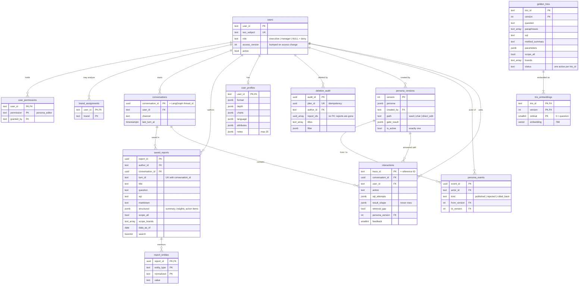

# Application-state ER diagram

Generated by hand from [postgres.sql](postgres.sql); the DDL wins if they disagree. Explained in [docs/lld/02-data.md](../../../docs/lld/02-data.md).
Not shown: the LangGraph checkpoint tables (owned by the checkpointer, keyed by `thread_id = conversation_id`).

